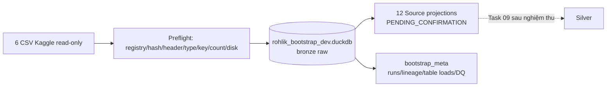

# Task 08A — Historical Source Bootstrap & Bronze Layer

> **LEGACY/HISTORICAL:** V4 production uses `config/sources.yaml` registry v4 and
> `config/contract.yaml`. This Task08A bootstrap intentionally uses the versioned
> `config/sources_task08a.yaml` adapter and never migrates an existing database.

Ngày xác minh: **19/10/2026**. Task 08A nạp sáu CSV Kaggle read-only vào một
DuckDB thử nghiệm riêng, giữ Bronze nguyên trạng và materialize 12 projection lịch
sử đúng direct mappings của Source Registry. Đây là **provisional bootstrap**, không
phải Data Warehouse chính thức và không phê duyệt schema/mapping nghiệp vụ.

## Phạm vi và luồng dữ liệu



Task 08A không tạo Silver, Gold, Mart, SQLite business tables, CSV Upload, batch
sync hay Parquet snapshot. Không sửa `src/db/duckdb.py`, `data/input.db` hoặc
`data/warehouse/rohlik.duckdb`.

## Phụ thuộc Source Registry và chốt an toàn

- `config/sources_task08a.yaml` phải load qua adapter Task 07/08A và đủ đúng 14 logical tables cũ.
- Sáu path phải thuộc allowlist `data/raw/`; SHA-256, header, strict types, row count,
  observed null counts và source/business keys phải khớp evidence Task 06.
- Output chỉ được là `.duckdb` trong `data/warehouse/`, không được resolve về
  `rohlik.duckdb`, SQLite, raw source hoặc path ngoài warehouse.
- Database có sẵn phải có ownership `TASK_08A`/format version tương thích. Database
  không có ownership nhưng chứa table bị từ chối; bootstrap không xoá dữ liệu lạ.
- Disk gate dùng estimate bảo thủ `4 × tổng bytes nguồn + 100 MiB`; parser dùng
  DuckDB SQL, 2 threads, memory limit 1 GiB, không tải Sales vào Pandas.

`VERIFIED` của source file chỉ chứng minh evidence file. Mọi schema/mapping approval
vẫn `PENDING_CONFIRMATION`; Task 08A không thay status trong Registry.

## Bronze và Source Tables

| Bronze table | CSV | Rows đã xác minh |
| --- | --- | ---: |
| `bronze.raw_orders` | `orders/train.csv` | 7.340 |
| `bronze.raw_orders_calendar` | `orders/train_calendar.csv` | 13.307 |
| `bronze.raw_sales` | `sales/sales_train.csv` | 4.007.419 |
| `bronze.raw_inventory` | `sales/inventory.csv` | 5.432 |
| `bronze.raw_sales_calendar` | `sales/calendar.csv` | 23.016 |
| `bronze.raw_weights` | `sales/test_weights.csv` | 5.390 |

Bronze dùng exact types đã quan sát trong Registry, giữ toàn bộ source columns và
mọi dòng. Không fill null, clip discount, deduplicate, aggregate hoặc loại SKU.
Provenance cấp file/run nằm trong `bootstrap_meta.source_lineage`, tránh nhân metadata
trên hơn bốn triệu dòng. Cột `id` của Orders được giữ; không tạo `order_index` giả.

| Source table | Nguồn | Grain / keys | Rows | Status / giới hạn |
| --- | --- | --- | ---: | --- |
| `sales_ecommerce.orders_daily` | orders | kho-ngày / warehouse,date | 7.340 | SUCCESS_PROVISIONAL |
| `sales_ecommerce.sku_sales_daily` | sales | SKU-ngày / unique_id,date | 4.007.419 | Giữ 52 null ở sales/total_orders |
| `marketing_pricing.prices` | sales | SKU-ngày / unique_id,date | 4.007.419 | Không tạo final_price |
| `marketing_pricing.promotions` | sales | SKU-ngày / unique_id,date | 4.007.419 | Giữ 32 discount cells âm; không max/clip |
| `marketing_pricing.min_order_value_changes` | orders | kho-ngày / warehouse,date | 7.340 | Không lấy precedence từ Calendar |
| `warehouse_ops.availability` | sales | SKU-ngày / unique_id,date | 4.007.419 | Không clip availability |
| `warehouse_ops.ops_events` | orders | kho-ngày / warehouse,date | 7.340 | Không tự thêm warehouse_limited |
| `category.product_master` | inventory | SKU-kho / unique_id | 5.432 | Giữ 42 SKU inventory-only |
| `planning.calendar` | hai calendars | kho-ngày / warehouse,date | 23.016 | Reconciled projection, provisional |
| `digital_product.user_activity` | orders | kho-ngày / warehouse,date | 7.340 | Không dùng như future-known feature |
| `external.weather` | orders | kho-ngày / warehouse,date | 7.340 | Giữ 270 null mỗi weather field |
| `finance.sku_weights` | weights | SKU-kho / unique_id | 5.390 | Weight không được hiểu là kg |

`finance.cost_params` và `hr.workforce_params` là `SKIPPED_MISSING`. Không có schema
table hay records giả được tạo cho hai bảng này.

## Calendar provisional

Hai raw calendars luôn được giữ riêng. Preflight chứng minh mỗi source unique theo
`warehouse,date`, overlap 13.307 keys và conflict null-safe bằng 0 cho cả năm shared
fields. `planning.calendar` được tạo bằng FULL OUTER JOIN của hai tập key unique:

- key chỉ có ở Sales Calendar dùng giá trị Sales;
- key chỉ có ở Orders Calendar dùng giá trị Orders;
- key overlap chỉ materialize khi mọi shared value bằng nhau null-safe;
- không fill null bằng 0, không nhân dòng và không đặt business precedence.

Tám Orders-only fields, gồm `warehouse_limited`, vẫn nằm ở
`bronze.raw_orders_calendar` và metadata deferred; chưa đưa vào projection. Nếu một
shared field conflict, `planning.calendar` chuyển `SKIPPED_PENDING`, run báo PARTIAL
và yêu cầu Planning phê duyệt precedence.

## CLI trên Windows

Chạy từ project root. Mặc định không ghi database và tương đương `--dry-run`:

```powershell
.\.venv\Scripts\python.exe -m src.validate_source_registry
.\.venv\Scripts\python.exe -m src.bootstrap_sources --dry-run
.\.venv\Scripts\python.exe -m src.bootstrap_sources --execute --provisional
.\.venv\Scripts\python.exe -m src.bootstrap_sources --validate-only
```

`--execute` bắt buộc đi cùng `--provisional`. Exit `0` là success/ready, `2` là
PARTIAL/SKIPPED_PENDING, `1` là failure. Có thể thêm `--json`; `--database` vẫn bị
path guard. Báo cáo JSON nằm ở ignored `data/exports/source_bootstrap/`.

## Kiểm tra bằng DuckDB hoặc DBeaver

Mở **chỉ** `data/warehouse/rohlik_bootstrap_dev.duckdb`, không mở nhầm database
chính thức để chỉnh sửa. Sau khi CLI đã đóng writer, dùng read-only nếu client hỗ trợ:

```sql
SELECT * FROM bootstrap_meta.bootstrap_runs ORDER BY started_at DESC;
SELECT * FROM bootstrap_meta.source_lineage ORDER BY file_id;
SELECT * FROM bootstrap_meta.table_loads ORDER BY table_name;
SELECT * FROM bootstrap_meta.dq_results ORDER BY check_id, object_name;

SELECT count(*) FROM bronze.raw_sales;
SELECT count(*) FROM bronze.raw_sales WHERE sales IS NULL;
SELECT count(*) FROM marketing_pricing.promotions WHERE type_0_discount < 0;
SELECT count(*) FROM planning.calendar;
```

Không giữ DBeaver connection mở trong lúc chạy `--execute`.

## Lineage, idempotency và recovery

`bootstrap_meta` có ownership, run state, source lineage, table load status và DQ
results. Fingerprint gồm format version, registry version/hash và sáu source hashes.

- Run mới ghi `RUNNING`; Bronze/projections/lineage/DQ được tạo trong một transaction.
- Thành công chuyển `SUCCESS`; lỗi rollback toàn bộ data transaction rồi ghi `FAILED`.
- Rerun cùng fingerprint và prior `SUCCESS` là no-op, giữ nguyên run ID và row counts.
- Fingerprint khác sau một successful run bị chặn để yêu cầu profiling/review; không
  tự replace lịch sử hợp lệ.
- Sau crash/failure: đóng mọi DuckDB client, chạy `--validate-only`, giữ DB/WAL,
  điều tra error trong run metadata rồi rerun cùng nguồn đã xác minh. Không xoá DB
  hoặc WAL tùy tiện.

## DQ và giới hạn nghiệp vụ

Kết quả thực tế: Bronze row counts PASS; projection keys duplicate=0; Calendar
overlap PASS; 52 null ở mỗi cột `sales`/`total_orders` được giữ; 32 discount cells
âm và 42 inventory-only SKU được giữ với WARN. WARN là điều kiện nguồn đã biết,
không phải permission để tự làm sạch.

Task 09 mới là nơi thiết kế Silver/DQ gates sau khi các quyết định null, discount,
currency/unit, known-at-as-of, calendar fields và update policy được duyệt. Không
SUM `total_orders` theo SKU để thay `orders`; không tạo max_discount/final_price.

## Readiness

- **Task 08A:** IMPLEMENTED / VERIFIED trong database thử nghiệm; 109 pytest PASS.
- **Task 08B:** NOT_READY — schema/mapping/update policy và Finance/HR chưa duyệt.
- **Task 09 Silver:** NOT_READY — chờ nghiệm thu Task 08A và quyết định DQ nghiệp vụ.

Task 08A thành công không đồng nghĩa Warehouse chính thức, Silver/Gold hay dashboard
đã hoàn thành.
