# CSV Upload Contract — kiến trúc nhập liệu

> **SUPERSEDED/LEGACY cho V4:** luồng SQLite → DuckDB dưới đây chỉ được giữ làm lịch
> sử thiết kế. V4 đã chốt Streamlit validate/confirm → INSERT trực tiếp DuckDB + audit
> trong cùng transaction. Chưa có implementation upload/entry trong V4-01; xem
> `Rohlik_DE_Local_First_V4_HR_Header_Dong_Bo.md` và `docs/source_registry.md`.

**Ngày:** 18/10/2026. **Trạng thái chức năng: PLANNED — chưa triển khai.**
Nhóm đã thống nhất CSV upload là phương thức nhập liệu chính; không bắt buộc nhập
từng record bằng form. Tài liệu này mô tả thiết kế, không tạo schema hoặc API thật.
Schema nghiệp vụ và các chính sách ghi cụ thể vẫn chờ phê duyệt theo bảng/phòng ban.

## 1. Luồng đã thống nhất, chờ triển khai

**Streamlit → SQLite → DuckDB (Bronze/Silver/Gold/Mart) → Parquet Snapshots → Streamlit.**

```mermaid
flowchart LR
    UI[Streamlit: chọn bảng theo quyền / tải template / upload CSV]
    UI --> V[Backend: kiểm tra schema / keys / types / DQ]
    V --> Preview[Xem trước và báo lỗi]
    Preview --> Confirm[Nhân viên xác nhận]
    Confirm --> Save[Kiểm tra lại quyền / dữ liệu / chống trùng]
    Save --> SQL[SQLite: records + audit + batch / cùng transaction]
    SQL --> Pending[PENDING_SYNC]
    Pending --> DE[DE chủ động chạy batch đồng bộ]
    DE --> DW[DuckDB: Bronze / Silver / Gold / Mart]
    DW --> Gate[Kiểm định trước công bố]
    Gate --> PQ[Parquet snapshot mới]
    PQ --> Read[Streamlit đọc bản đã publish]
```

Mọi bước upload/validation/audit/sync/publish trong sơ đồ đều PLANNED. Hiện chỉ có
connection/transaction và CLI hạ tầng SQLite/DuckDB; chưa có các bảng records,
upload batch, audit, pipeline hoặc publisher. Không có command upload/sync để chạy.

## 2. Chọn bảng, template và xác nhận

- Streamlit cho chọn phòng ban/bảng theo quyền, tải template theo schema_version,
  upload CSV và xem trước dữ liệu cùng lỗi theo dòng/cột. Backend phải kiểm tra
  quyền thực tế, không tin tên bảng hay người gửi do client tự truyền.
- Template mô tả cột bắt buộc, kiểu, đơn vị, định dạng ngày và business keys đã
  được duyệt; không suy diễn schema từ CSV đầu tiên hoặc tự tạo bảng mới.
- Preview chưa ghi records vào SQLite. Chỉ sau khi nhân viên xác nhận đúng nội
  dung đã kiểm tra, backend mới thực hiện thao tác lưu.
- Khi xác nhận phải kiểm tra lại quyền, schema_version, dấu nhận diện nội dung và
  các điều kiện phụ thuộc dữ liệu hiện tại để tránh preview cũ hoặc dữ liệu bị đổi.
  Nếu không còn hợp lệ, yêu cầu xem lại/xác nhận lại, không âm thầm sửa payload.

## 3. Validation và Data Quality

| Nhóm | Nội dung backend cần kiểm tra theo contract từng bảng |
| --- | --- |
| Cấu trúc CSV | Định dạng/encoding/delimiter được duyệt; header thiếu, dư, trùng; file rỗng; giới hạn dung lượng/số dòng. Không thực thi nội dung file. |
| Schema | Cột bắt buộc/tùy chọn, schema_version, quy tắc cột ngoài template; không tự mở rộng schema. |
| Data types | Ép kiểu có kiểm soát, ngày/timezone, đơn vị, null; giữ leading zero của mã nếu là chuỗi. Không âm thầm chuyển giá trị lỗi thành 0. |
| Business keys | Key không null, trùng key trong file và đối chiếu key đã có; phạm vi key theo bảng/phòng ban. |
| DQ nghiệp vụ | Miền giá trị, khoảng hợp lệ, quan hệ/JOIN, ràng buộc chéo cột và tham số được chủ dữ liệu duyệt. |
| Chính sách ghi | INSERT hay UPSERT, quyền cập nhật, cột được sửa, xử lý xung đột với dữ liệu hiện có. |

Lỗi cần trả số dòng/cột, mã lỗi, lý do và cách sửa; không làm lộ dữ liệu phòng khác.
Chính sách khi file có cả dòng hợp lệ và lỗi **chưa chốt**: từ chối toàn file hay
cho lưu tập hợp lệ. Không tự chọn bỏ dòng. Nếu cho lưu một phần, phải hiển thị rõ
tập được nhận/tập bị loại, số lượng và yêu cầu người gửi xác nhận trước khi lưu.
Backend luôn chỉ lưu records hợp lệ theo chính sách đã được phê duyệt.

## 4. Metadata upload batch — thiết kế logic, không phải DDL

| Metadata | Ý nghĩa |
| --- | --- |
| `batch_id` | Định danh ổn định cho batch; cơ chế sinh cần chốt. |
| Tên file | Tên nguồn để truy vết, không dùng trực tiếp làm đường dẫn lưu hoặc tên bảng. |
| Người gửi / thời điểm | Danh tính đã xác thực và thời điểm server có timezone. |
| Phòng ban / bảng đích | Định danh trong danh sách được phép, không SQL identifier tùy ý. |
| Số dòng | Tổng số dòng dữ liệu, hợp lệ, bị loại; số INSERT/UPDATE/không đổi khi chính sách yêu cầu, định nghĩa cách đếm cần thống nhất. |
| Trạng thái | Trạng thái batch, lỗi nếu có; sau commit thành công là `PENDING_SYNC`. |
| Schema/validation version | Version template, quy tắc kiểm tra và chính sách ghi dùng để xử lý. |
| Nhận diện nội dung | Hash/dấu nhận diện và phạm vi chống trùng đã duyệt; liên kết batch gốc nếu upload lại. |
| Tham chiếu đồng bộ | Sync run/snapshot/version và lỗi để truy vết về sau; chưa có implementation. |

Metadata và records là hai phần khác nhau; không buộc thêm các cột này vào mọi bảng
nghiệp vụ khi chưa thiết kế schema. Thời điểm tạo batch/ghi metadata cho lần bị từ
chối, lưu file gốc upload và thời hạn giữ log/file vẫn cần xác nhận.

## 5. Transaction và audit

Sau xác nhận, backend dùng connection riêng, transaction ngắn để kiểm tra chống
trùng trong lần ghi, INSERT/UPSERT records hợp lệ, ghi audit event và metadata batch
với trạng thái `PENDING_SYNC`, rồi commit **cùng một transaction SQLite**.
Nếu ghi records, audit hoặc metadata thất bại, rollback toàn bộ phần lưu; không
báo đã nhận thành công. Không chờ tương tác người dùng hoặc chạy ETL trong transaction.

Audit tối thiểu phải truy về batch, actor, bảng/phòng ban, thời điểm và thao tác;
cần chốt mức chi tiết theo batch/record, thông tin thay đổi và quyền xem audit.
Không coi upload file trong UI là audit đã được ghi. Log lỗi của transaction thất
bại nếu cần phải có cơ chế riêng đã duyệt; audit trong transaction bị rollback sẽ
không tồn tại. Không ghi secrets hoặc toàn bộ nội dung nhạy cảm tùy tiện vào log.

UPSERT chỉ dùng khi key, quy tắc xung đột, cột được cập nhật và quyền sửa đã duyệt.
Không mặc định last-write-wins, xoá thay thế bảng hoặc thay toàn bộ lịch sử.

## 6. Upload trùng và retry

Nhóm yêu cầu chống xử lý trùng nhưng **chưa chốt thuật toán/chính sách**. Cần chọn
nhận diện theo byte file hay dữ liệu đã chuẩn hoá; nếu dùng chuẩn hoá phải định
nghĩa encoding, thứ tự dòng/cột, null và kiểu dữ liệu. Tên file không đủ để chống trùng.
Phạm vi cần xét bảng/phòng ban, quyền người gửi và version liên quan, tránh kết luận
hai batch khác mục đích là trùng chỉ vì file giống nhau.

- Upload lại cùng nội dung đã commit không được tạo thêm records/audit thay đổi dữ
  liệu như một lần ghi mới. Cần chốt trả lại batch cũ hay từ chối với thông báo trùng;
  audit “upload trùng” nếu có phải phân biệt với audit ghi records.
- Hai lần xác nhận đồng thời hoặc retry sau mất mạng phải được kiểm tra chống trùng
  tại transaction ghi, không chỉ ở preview. Cơ chế ràng buộc/idempotency chưa triển khai.
- Phải phân biệt cùng file đã xử lý, trùng business key trong file và key đã có trong
  database. Chống trùng batch không thay thế chính sách INSERT/UPSERT theo key.
- Sửa nội dung sau lần lỗi có thể là batch mới liên kết batch cũ theo chính sách;
  retry sync dùng batch đã commit, không INSERT lại SQLite.

## 7. Đồng bộ và publish

Upload thành công chỉ nghĩa dữ liệu đã commit SQLite ở `PENDING_SYNC`, **không**
nghĩa dữ liệu đã xuất hiện trên dashboard phân tích. DE chủ động chạy batch từ
SQLite sang DuckDB; không để Streamlit tự ghi DuckDB hoặc tự chạy model sau upload.

Thiết kế sync cần chọn ranh giới input nhất quán (batch/version/watermark) và
idempotency khi retry để không nạp lặp. SQLite và DuckDB không có transaction chung
trong thiết kế này; checkpoint/trạng thái sync phải có quy tắc phục hồi khi một bên
commit còn bên kia lỗi. Nếu có UPSERT trong lúc chờ sync, phải chốt cách bảo toàn
phiên bản batch, không chỉ đọc trạng thái mới nhất rồi bỏ mất lineage.

Chỉ sau khi kiểm định các tầng và output thành công mới publish **Parquet snapshot
mới hoàn chỉnh**. Nếu thất bại, không công bố bản dở; giữ bản publish hợp lệ trước
đó và hiển thị snapshot/as_of phù hợp. Trạng thái sau `PENDING_SYNC`, điều kiện retry
và thời điểm coi batch đã đồng bộ/publish cần chốt; không tự gán đã thành công.

Mô hình/optimization sau này tuân theo [Model Integration Guide](model_integration_contract.md):
output model qua kiểm định trước publish, không sửa Silver/Gold hay SQLite tùy tiện.

## 8. Dữ liệu gốc và Finance/HR

Giữ nguyên sáu CSV Kaggle đã được nhóm nhắc đến, không chỉnh sửa/ghi đè, không biến
chúng thành đích lưu upload. Việc bảo toàn bộ gốc không xác nhận đó là bộ dữ liệu
chính thức hoặc đầy đủ cho BT1–BT8. Không đổi đường dẫn hoặc di chuyển file nguồn.
CSV nhân viên và các output về sau phải có lineage riêng, không commit vào Git.

Hai bảng Finance/HR có thể nhận CSV riêng **chỉ sau khi schema và giá trị được
phê duyệt**. Chưa tạo tên bảng/cột, template hay giá trị giả định cho hai bảng này.

## 9. Trách nhiệm và các quyết định còn mở

| Bên | Trách nhiệm dự kiến |
| --- | --- |
| DE + chủ dữ liệu phòng ban | Chốt schema/key/types/DQ, template/version, INSERT/UPSERT và Finance/HR; DE phụ trách sync, kiểm định Warehouse và phối hợp publish. |
| Thành viên Streamlit | UI chọn bảng theo quyền, tải template/upload/preview/lỗi/xác nhận, hiển thị PENDING_SYNC và thông tin snapshot. |
| Người phụ trách backend (cần phân công) | Kiểm tra quyền/schema/DQ, chống trùng, transaction SQLite, metadata và audit; không tin kiểm tra UI. |
| DE + người tích hợp/Streamlit | Chốt ranh giới batch/version sync, publisher, trách nhiệm vận hành/retry và dữ liệu UI đọc. |
| Chủ dự án / người duyệt | Phê duyệt phân quyền, chính sách cập nhật, audit và bảo quản dữ liệu. |

Trước triển khai cần xác nhận:

1. Schema/key/types/đơn vị/DQ và template cho từng bảng; phạm vi quyền phòng ban.
2. INSERT hay UPSERT; cột được sửa, xung đột, xử lý upload sai và quyền hiệu chỉnh.
3. Từ chối toàn file hay lưu phần hợp lệ; quy tắc xác nhận và báo dòng lỗi.
4. Encoding/delimiter, giới hạn file/dòng, thời gian giữ upload và báo lỗi.
5. Phạm vi/hash chống trùng, response khi trùng, retry và đồng thời.
6. Metadata/audit chi tiết, người triển khai backend, quyền xem và thời hạn giữ.
7. Version/watermark sync, trạng thái sau PENDING_SYNC, recovery liên SQLite/DuckDB.
8. Gate kiểm định và công bố Parquet, tên/version snapshot và hiển thị dữ liệu cũ.
9. Schema và giá trị Finance/HR, người có thẩm quyền phê duyệt.

## 10. Nghiệm thu tương lai — tất cả chưa triển khai

- [ ] Quyền UI và backend khớp; template đúng schema đã duyệt.
- [ ] Preview/validation chưa lưu record; nhân viên xác nhận đúng payload.
- [ ] Records + audit + metadata commit cùng transaction, lỗi rollback đầy đủ.
- [ ] Upload trùng/retry/đồng thời không xử lý lặp; INSERT/UPSERT đúng chính sách.
- [ ] Lưu xong PENDING_SYNC; DE sync chủ động, retry không nạp lặp hoặc mất version.
- [ ] Chỉ publish Parquet sau kiểm định thành công; Streamlit không đọc bản dở.
- [ ] Sáu CSV gốc không thay đổi; Finance/HR không có schema/giá trị chưa được duyệt.

Chưa có bằng chứng test cho luồng này. Test hạ tầng SQLite/DuckDB hiện có không chứng
minh CSV upload, audit, sync hoặc publish đã hoạt động.
