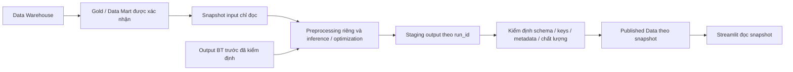

# Model Integration Guide — BT1–BT8

**Phiên bản tài liệu:** 0.2 — DRAFT. **Cập nhật:** 19/10/2026.
**Trạng thái tích hợp:** PLANNED, chưa triển khai hoặc nghiệm thu model nào.
Baseline hạ tầng: commit `be20f7c` (Python, SQLite, DuckDB). Tài liệu này không xác
nhận notebook/model đã chạy và không quyết định schema Gold/Data Mart chính thức.

## Nguồn và cách đọc

- [Setup Tutorial](setup_tutorial.md): trạng thái source và hạ tầng đã có.
- [Source Profiling](data_profiling_report.md), [Data Dictionary](data_dictionary.md),
  [Source Mapping](source_mapping.md), [Source Registry](source_registry.md) và
  [Data Quality Rules](data_quality_rules.md): bằng chứng dữ liệu dùng chung hiện có.
- [Hướng dẫn Rohlik v3 — DOCX](../Rohlik_Decision_Hub_Huong_dan_thuc_hien_v3.docx),
  mục D1, E0, E1 và E2–E9: nguồn tham khảo chuỗi bài toán; có
  [bản Markdown](../Rohlik_Decision_Hub_Huong_dan_thuc_hien_v3.md) để tra cứu.
- [Cẩm nang hệ thống hoá](../CAM_NANG_Kien_thuc_He_thong_hoa.md), chương 16,
  đặc biệt 16.0–16.1: ranh giới DE, dữ liệu dùng chung, kiểm định và truy vết.

`REFERENCE_ONLY` = theo tài liệu, chưa được notebook/source/output thực tế xác minh.
Thông tin chưa có bằng chứng phải được ghi rõ; không kết luận thành viên chưa làm.
Các interface, metadata và đường dẫn mới dưới đây là **đề xuất cần nhóm duyệt**,
không phải module/CLI hoặc thư mục đã được tạo. Checklist nhận file nằm tại
[Model Handover Checklist](model_handover_checklist.md); không yêu cầu nhóm điền lại
thông tin đã có bằng chứng trong notebook, source code, output hoặc trao đổi kỹ thuật.

## A. Integration Architecture

Luồng dự kiến sau khi dữ liệu và model được chốt:



Tất cả luồng trên là PLANNED. Hiện mới có hạ tầng database, chưa có Warehouse nghiệp
vụ, snapshots, publisher, Model Runner hoặc Streamlit integration.

| Bên phụ trách | Trách nhiệm | Ranh giới |
| --- | --- | --- |
| Data Engineer | Chuẩn hoá nguồn và preprocessing dùng chung; Silver/Gold/Mart, dictionary, chất lượng, snapshot/version đầu vào khi được giao triển khai. | Không tự quyết định preprocessing/thuật toán riêng của BT. Gold/Mart phải dựa trên bằng chứng dữ liệu và quyết định nghiệp vụ đã được duyệt. |
| Chủ model BT1–BT8 | Preprocessing và feature engineering đặc thù, training, inference/tối ưu, artifacts, dependencies, metric và giải thích kết quả. | Không sửa Silver/Gold, tự thay schema hoặc ghi tuỳ tiện vào SQLite/Warehouse. |
| Người tích hợp (phụ trách Streamlit/tích hợp) | Chuyển notebook thành chương trình gọi được, adapter input/output, Model Runner, thứ tự chạy, xử lý lỗi, kiểm định output và kết nối Streamlit. | Không tự sửa logic mô hình để làm kết quả “khớp”; mọi thay đổi ngữ nghĩa cần chủ model xác nhận. |
| DE + người tích hợp + chủ model | Duyệt mapping, version, dependencies giữa BT và chính sách publish; phân công người vận hành publisher. | Chưa chốt tên người chịu trách nhiệm và quyền ghi. |

Model chỉ nhận dữ liệu đầu vào được cấp và ghi output của lượt chạy vào staging.
Streamlit đọc dữ liệu đã publish, không chia sẻ connection ghi DuckDB giữa các phiên.
Chỉ tác vụ DE được phân công ghi Warehouse theo quy tắc vận hành DuckDB hiện tại.

## B. Model Input Specification

Với mỗi BT, đối chiếu trực tiếp notebook/source, input/output và artifact thực tế.
Chưa có mapping từ dataset nghiên cứu sang Gold/Mart thì ghi rõ là chưa xác minh.

| Nhóm thông tin | Cần xác nhận cho từng model |
| --- | --- |
| Định danh | Mã/tên BT thực tế, chủ model, model_version và phiên bản code/notebook. |
| Nguồn | File/bảng thực sự đọc, nguồn gốc, quyền truy cập, raw/clean/features, file bổ sung và snapshot/hash nếu có. |
| Schema | Cột bắt buộc/tùy chọn, datatype chính xác, nullability, đơn vị, định dạng ngày và timezone; không tự suy ra từ tên cột. |
| Grain và keys | Một dòng đại diện cho gì; business key, tính duy nhất; JOIN keys, cardinality và cách xử lý không khớp. |
| Thời gian | Khoảng lịch sử cần đọc, cutoff/as_of, cửa sổ feature, horizon, tần suất và ngày có thể biết dữ liệu. |
| Feature riêng | Cell/script, thứ tự biến đổi, encoder/scaler/features, cột target cần khi train và cột không được dùng khi inference. |
| Missing/invalid values | Quy tắc xử lý mỗi cột/nhóm; thống kê fit trên tập nào; khi nào báo lỗi hoặc không đủ dữ liệu. Không mặc định fill 0. |
| Phụ thuộc BT khác | Output/phiên bản/run_id nguồn, schema, key/horizon, điều kiện sẵn sàng và bắt buộc hay tùy chọn. |
| Mapping DE → model | Cột nguồn/cột model, đổi tên/kiểu/đơn vị, lọc và chuyển grain; chủ model + DE ký xác nhận bằng output đối chiếu. |

Đầu vào tích hợp nên là snapshot bất biến/chỉ đọc cho mỗi run; ghi data_version và
as_of để chạy lại không âm thầm đọc dữ liệu mới. Nếu nhiều nguồn, liệt kê từng
snapshot, không gộp thành nhãn “latest”. Phải chốt as_of là thời điểm dữ liệu được
biết; forecast_date là ngày cần dự báo, không đồng nghĩa thời điểm chạy.

Preprocessing dùng chung do DE quản lý; preprocessing riêng do model quản lý.
Không ép mọi BT dùng cùng thuật toán, scaler, imputation hay schema feature.
Phân biệt fit_transform lúc train và transform lúc inference; lưu trạng thái đã fit
nếu cần. Không fit lại encoder/scaler bằng dữ liệu tương lai hoặc target test.
Các quy tắc này cần đối chiếu notebook trước khi chấp nhận mapping, không tự viết
Gold/Mart để ép notebook chạy.

## C. Model Execution Guide

### Tách nghiên cứu, training và inference

Notebook Colab có thể tiếp tục dùng nghiên cứu, backtest, đánh giá và huấn luyện.
Không bắt chủ model viết lại notebook chỉ để bàn giao. Người tích hợp cùng chủ
model xác định phần inference/tối ưu tối thiểu có thể tái chạy trên hệ thống.
Không tự train lại mỗi lần Streamlit refresh hoặc người dùng mở dashboard.

- Training: ghi input snapshot, split thời gian, seed, metric, tham số, dependencies
  và artifact/version; chấp nhận quy trình Colab đã có nếu tái tạo được và được duyệt.
- Inference: tải artifact + preprocessing đã fit, đọc snapshot được chỉ định, tạo
  output. Với mô hình không cần artifact hoặc bài toán tối ưu, chủ model ghi rõ
  cách tính, tham số, dữ liệu lịch sử cần dùng và lý do không có artifact.
- Nếu phương pháp bắt buộc fit lại mỗi lượt, khai báo điều đó, thời gian và điều kiện
  chạy; nhóm duyệt trước thay vì gọi đó là inference không cần training.

### Interface minh hoạ — chưa tồn tại, không chạy được trong repository

Đề xuất một hàm adapter cho mỗi BT, giữ code thuật toán phía sau tùy model:

```python
# DESIGN ONLY: chữ ký đề xuất; không có module triển khai.
def run_model(
    *,
    input_manifest: "Path",  # liệt kê các file/snapshot chính và phụ thuộc BT
    output_dir: "Path",      # staging riêng, không phải Gold hay published
    run_id: str,
    config_path: "Path",     # model_version, as_of, tham số, artifact nếu cần
) -> "RunResult": ...       # trạng thái + output manifest + diagnostics
```

Đề xuất CLI tương đương để người tích hợp quyết định sau khi nhận notebook:

```text
DESIGN ONLY — không phải command hiện có:
python -m <adapter_module> --input-manifest <file> --output-dir <staging-dir>
    --run-id <unique-id> --config <config-file>
```

input_manifest cho phép nhiều input và phụ thuộc; CLI phải thống nhất với interface
Python đã chọn, không bắt buộc triển khai cả hai nếu không cần. Mọi path đi qua
tham số/config và `pathlib`; không hardcode Google Drive, `/content/`, tài khoản
Windows hoặc current working directory. Colab mount/download cần được thay bằng
cơ chế nhận input được xác nhận, không coi việc sửa path là đủ để model chạy local.

### Dependencies và artifacts

Chủ model cung cấp phiên bản Python/thư viện đặc thù thực tế đang dùng, cài đặt bổ
sung trong notebook, CPU/GPU và file ngoài. `requirements.txt` hiện tại là môi trường
hạ tầng, không chứng minh đã đáp ứng mọi model. Người tích hợp kiểm tra tương thích
Windows 11/Python 3.13 trước khi chọn môi trường dùng chung; không tự nâng/hạ thư viện
hoặc ép tất cả BT vào một môi trường khi có xung đột.

Nếu không chạy local: ghi nguyên nhân có bằng chứng (gói không tương thích, GPU,
API, dữ liệu không truy cập được...), chủ xử lý và phương án cần duyệt: điều chỉnh
adapter, tách môi trường hoặc tạm chạy ở Colab rồi bàn giao snapshot đã xác minh.
Phương án tách môi trường/remote chưa được triển khai và không tự bổ sung công nghệ.
Lượt chạy tích hợp chưa đáp ứng điều kiện giữ BLOCKED.

Artifact nếu có phải đi kèm model_version, đường dẫn/hash, cách load, framework và
preprocessor liên quan. File không áp dụng ghi N/A có lý do, không tạo artifact giả.
Chỉ load artifact từ nguồn nhóm xác nhận; không commit dataset, credentials hoặc
model binary vào source một cách mặc định.

### Kết quả chạy và lỗi — quy ước đề xuất

| Trạng thái run | Ý nghĩa / hành động |
| --- | --- |
| SUCCESS | Model chạy xong và output đạt kiểm định; chưa tự đồng nghĩa đã publish. Ghi published_snapshot_id riêng khi publish thành công. |
| FAILED | Đã chạy nhưng lỗi tính toán, execution hoặc validation; giữ diagnostics, không publish output dở. |
| BLOCKED | Không thể bắt đầu vì thiếu input/artifact/dependency bắt buộc, hoặc môi trường chưa đáp ứng; ghi thiếu gì và upstream nào. |
| SKIPPED | Không chạy vì ngoài phạm vi lượt chạy hoặc upstream không thành công; ghi lý do, không coi là thành công. |

CLI dự kiến phải trả exit code khác 0 cho FAILED/BLOCKED; quy tắc SKIPPED và cách
runner truyền trạng thái phải được người tích hợp xác nhận. Không dùng file output
cũ hoặc file rỗng để giả SUCCESS. Mỗi lần thử có run_id riêng hoặc attempt_id gắn
run_id; không ghi đè output đã publish, không âm thầm thay kết quả của run cũ.

## D. Model Output Specification

Giữ **payload riêng của từng BT** và metadata truy vết chung. Không ép forecast,
optimization, causal effect, comparison và growth curve vào một bảng dự báo chung.
Thông tin không áp dụng (ví dụ ngày dự báo cho bảng so sánh) phải có lý do rõ ràng.

| Phần | Thông tin cần chốt |
| --- | --- |
| Định danh output | BT/model, output_name, file/tên bảng logic, định dạng và schema_version; một model có thể có nhiều output. |
| Grain và liên kết | Grain của mỗi output, business/JOIN keys, kiểm tra duy nhất; ngày dự báo hoặc thời kỳ/kịch bản nếu áp dụng. |
| Giá trị | Cột dự báo/tối ưu/metric, datatype, đơn vị, quantile nếu có, null/giới hạn hợp lệ và semantics do chủ model xác nhận. |
| Phiên bản | model_version, code/notebook version, artifact/preprocessor version hoặc N/A có lý do. |
| Nguồn chạy | run_id, input data_version và as_of, danh sách upstream BT/run_id/snapshot, cấu hình/seed nếu áp dụng. |
| Thời điểm và kiểm định | Thời gian bắt đầu/kết thúc có timezone, số dòng, hash file, kết quả schema/key/quality checks. |
| Trạng thái | Run status ở C, lý do lỗi/thiếu input; output status và publish status tách biệt. Không ghi prediction giả cho run lỗi. |

Đề xuất dùng output manifest kèm file kết quả, chứa metadata cấp run/nguồn và danh
sách từng output. Các khóa/giá trị nghiệp vụ ở payload; run_id/model_version có thể
ở payload hoặc manifest được liên kết duy nhất, nhưng phải truy vết được sau publish.
Tên cột/kiểu dữ liệu cuối cùng là nội dung phải xác nhận, chưa phải schema thật.

Quy trình ghi dự kiến: model → staging riêng theo BT/run → người tích hợp kiểm định
schema, key, số dòng và quy tắc nghiệp vụ đã duyệt → publish snapshot hoàn chỉnh.
Staging chỉ là đề xuất, chưa tạo thư mục. Không để notebook tự ghi SQLite, Silver,
Gold hoặc thay kết quả bài khác. `data/published/` đã có thư mục nhưng chưa có publisher.

Snapshot publish cần bất biến, gắn phiên bản và manifest; chỉ đổi con trỏ bản hiện
hành khi mọi file cần thiết đã sẵn sàng. Nếu thất bại, không lộ snapshot một phần;
bản hợp lệ trước đó nếu được giữ phải hiển thị as_of/run_id và trạng thái cũ cho UI,
không trình bày như kết quả vừa chạy. Cách publish và cập nhật con trỏ cần người tích
hợp chốt với DE, chưa có implementation bảo đảm atomicity.

## E. Model Dependencies & Execution Order

Bảng dưới **chỉ là REFERENCE_ONLY**, lấy từ Rohlik v3 D1 và E2–E9. Các tên `gold.*`,
`pred.*` là tên trong tài liệu tham khảo, không phải bảng đã có hoặc schema được duyệt.
“Không thấy BT upstream” không chứng minh model độc lập với mọi nguồn bên ngoài.

| BT / định hướng tham khảo | Input/output theo v3 | BT upstream theo v3 | Đã xác nhận bởi chủ model | Trạng thái cần chốt |
| --- | --- | --- | --- | --- |
| BT1 — dự báo đơn | `gold.fct_warehouse_day` → `pred.fc_orders`, bảng so sánh | Không thấy BT upstream ở D1 | Chưa có bằng chứng | PENDING_CONFIRMATION: nguồn orders/order_index, horizon và output từng chuỗi. |
| BT2 — ca kho/tài xế | `pred.fc_orders`, `gold.dim_warehouse` → `pred.staff_plan`, `pred.driver_plan`, so sánh | BT1 (chuỗi orders) | Chưa có bằng chứng | PENDING_CONFIRMATION: quantile, năng suất/lương và nguồn tham số thực tế. |
| BT3 — nhu cầu bị mất | `gold.fct_sku_day` → `pred.lost_sales`, summary, so sánh | Không thấy BT upstream ở D1 | Chưa có bằng chứng | PENDING_CONFIRMATION: sales/availability, ước lượng nhu cầu và keys. |
| BT4 — dự báo SKU | `gold.fct_sku_day`, `pred.lost_sales`, `pred.fc_orders` → `pred.fc_sku`, so sánh | BT3; BT1 (chuỗi order_index) | Chưa có bằng chứng | PENDING_CONFIRMATION: mapping thời gian, nhu cầu hiệu chỉnh, quantile và dependencies bắt buộc/tùy chọn. |
| BT5 — hiệu ứng giảm giá | `gold.fct_sku_day` → `pred.promo_effect`, effect theo loại, so sánh | Không thấy BT upstream ở D1 | Chưa có bằng chứng | PENDING_CONFIRMATION: confounders, grain hiệu ứng và phạm vi áp dụng. |
| BT6 — lượng đặt | `pred.fc_sku`, `pred.lost_sales`, `gold.params_cost` → `pred.replenishment`, so sánh | BT4; BT3 | Chưa có bằng chứng | PENDING_CONFIRMATION: quantile, giá vốn/huỷ, keys và nguồn tham số. |
| BT7 — markdown | `pred.fc_sku`, `pred.promo_effect`, `pred.replenishment`, `pred.lost_sales`, `gold.params_cost` → `pred.markdown_plan`, so sánh | BT4; BT5; BT6; BT3 | Chưa có bằng chứng | PENDING_CONFIRMATION: lịch tồn/hạn dùng thực tế, hiệu ứng khuyến mãi, output cần dùng. |
| BT8 — tăng trưởng kho | `gold.fct_warehouse_day` → `pred.growth_curves`, `pred.growth_projection`, so sánh | Không thấy BT upstream ở D1 | Chưa có bằng chứng | PENDING_CONFIRMATION: ngày mở kho, lịch sử, kịch bản và grain output. |

Thứ tự theo phụ thuộc tài liệu: nhóm BT1/BT3/BT5/BT8 → BT2 sau BT1; BT4 sau BT1+BT3
→ BT6 sau BT4+BT3 → BT7 sau BT3+BT4+BT5+BT6. Đây là nhóm logic, không yêu cầu triển
khai chạy song song. Có thể chạy tuần tự BT1→BT2→BT3→BT4→BT5→BT6→BT7→BT8 nếu đồ thị
này được xác nhận; người tích hợp phải xây lại DAG từ notebook thực tế, kiểm tra chu
trình và độ sẵn sàng của từng upstream trước khi chạy.

Mỗi cạnh cần xác nhận producer/consumer, output cụ thể, phiên bản, key/grain, khoảng
ngày, as_of, bắt buộc/tùy chọn, người duyệt hai phía và bằng chứng. Không chỉ ghi
“phụ thuộc BT1” vì orders và order_index phục vụ các bài khác nhau.

**Khác biệt với v3:** D1 gợi ý đầu vào tạm như total_orders thật, trung bình 28 ngày
hoặc giả định lift khi thiếu kết quả bài trước; E0 gợi ý model ghi thẳng `pred.*`.
Trong thiết kế hiện tại, không dùng những fallback đó để giả kết quả tích hợp.
Thiếu input/output bắt buộc → BLOCKED; consumer bị bỏ qua vì upstream lỗi → SKIPPED
kèm nguyên nhân. Không dùng dữ liệu tương lai, tự sinh kết quả giả hoặc âm thầm lấy
run cũ. Baseline nghiên cứu nếu cần phải được duyệt và ghi riêng, không thay upstream.
Output phải qua staging/validation/publish, không notebook ghi tuỳ tiện vào database.

## F. Notebook-to-Production Handover

Đây là công việc tích hợp **trong tương lai**, chưa thực hiện. Người tích hợp chủ trì,
chủ model xác nhận logic/kết quả; DE xác nhận mapping dữ liệu dùng chung.

1. Nhận `.ipynb` và tất cả input/output/file bổ sung; lập danh sách nguồn và version.
   File model/dependencies đặc thù thu thêm nếu có. Dùng checklist, không bắt viết lại notebook.
2. Chạy lại notebook theo hướng dẫn trên snapshot đã nhận; ghi môi trường, thứ tự
   cell, seed, output và log. Nếu không tái lập được, ghi trở ngại, không coi là đạt.
3. Xác định preprocessing dùng chung/riêng, phần training, artifact và inference/tối
   ưu. Hỏi chủ model về trạng thái ẩn của Colab, dữ liệu mount và package cài trong cell.
4. Cùng DE và chủ model xác nhận mapping input sang Gold/Mart đã duyệt. Chưa có
   Gold/Mart hoặc bằng chứng mapping thì ghi BLOCKED cho bước liên quan, không tự tạo schema.
5. Tách inference/optimization thành adapter/module Python khi phù hợp, tham số hoá
   path/config và kiểm tra Windows/Python 3.13. Notebook nghiên cứu vẫn được giữ.
6. Chuẩn hoá input/output manifest, run_id và metadata theo B–D; giữ payload riêng.
7. Người tích hợp triển khai Model Runner, dependency checks và lỗi theo E/C sau
   khi được giao triển khai; runner chưa có trong repository hiện tại.
8. Đối chiếu output tích hợp với notebook trên cùng snapshot/config/artifact/seed;
   thống nhất dung sai/metric trước, ghi khác biệt và chủ model duyệt.
9. Chỉ publish output đạt gate rồi cho Streamlit đọc snapshot; nghiệm thu cả trường
   hợp thiếu input, lỗi model, publish thất bại và không hiển thị kết quả dở.

## G. Verification & Acceptance Criteria

Nghiệm thu **tài liệu thiết kế** khác nghiệm thu **model đã tích hợp**. Hiện chưa có
bằng chứng để đánh PASS cho bất kỳ model nào. Tiêu chí dưới đây dùng ở giai đoạn sau:

| Tiêu chí mỗi BT | Bằng chứng cần có | Người duyệt |
| --- | --- | --- |
| Nhận đủ notebook/code, dữ liệu và file liên quan | Link/file truy cập được, phiên bản, inventory raw/clean/features/output. | Chủ model + người nhận |
| Dependencies/artifact đủ hoặc N/A có lý do | Môi trường, phiên bản, cách load, CPU/GPU và trở ngại được ghi rõ. | Chủ model + người tích hợp |
| Tái tạo notebook | Hướng dẫn thực thi, log và output trên snapshot được chỉ định. | Người tích hợp + chủ model |
| Input schema/mapping được xác nhận | Cột/type/unit/key/grain/time, preprocessing boundary và nguồn đã duyệt. | DE + chủ model |
| Output schema được xác nhận | Payload riêng, key/ngày/đơn vị, metadata và version, validation rules. | Chủ model + người tích hợp; DE cho liên kết |
| Phụ thuộc được xác nhận | Producer/consumer ký cùng output/run/snapshot/horizon, không vòng lặp chưa giải quyết. | Các BT liên quan + người tích hợp |
| Kết quả tích hợp khớp thử nghiệm | Cùng input/config/artifact, metric và dung sai định trước, báo cáo khác biệt. | Chủ model + người tích hợp |
| Thiếu dữ liệu/lỗi được xử lý | Bằng chứng BLOCKED/SKIPPED/FAILED, không publish output dở hoặc giả. | Người tích hợp |
| Publish/Streamlit đúng snapshot | Truy vết được run/as_of, chỉ đọc bản đã duyệt; hiển thị trạng thái cũ nếu có. | Người tích hợp + bên nghiệm thu |

Biên bản kiểm tra mỗi BT cần: trạng thái CHƯA XÁC MINH/PASS/FAIL, người xác nhận, ngày,
phiên bản code/data/model và link bằng chứng. PASS khi toàn bộ tiêu chí áp
dụng đạt; N/A phải có lý do được duyệt. Hiện mọi BT vẫn PENDING, không dùng số test
hạ tầng SQLite/DuckDB làm bằng chứng tích hợp model.

## Quyết định còn cần thống nhất

- Chủ model và người tích hợp cụ thể của từng BT, người duyệt và cách liên hệ.
- Dataset chính thức, mapping Gold/Mart, schema/version, thời gian/as_of và keys.
- Đồ thị dependencies thực tế và input nào bắt buộc; tiêu chí sẵn sàng của upstream.
- Chọn Python interface hay CLI, định dạng manifest/file output và quy tắc run/attempt.
- Dependencies/artifacts và phương án cho model chưa chạy được Windows/Python 3.13.
- Metric/dung sai đối chiếu, quyền staging/publish, trách nhiệm publisher và cách UI
  báo lỗi/dữ liệu cũ. Chưa có quyết định nào được thay bằng giả định đã triển khai.

## Lịch sử

| Ngày | Thay đổi | Trạng thái |
| --- | --- | --- |
| 19/10/2026 | Retire workflow Data Contract BT1–BT8; giữ hướng dẫn tích hợp và xác minh trực tiếp từ notebook/source/output/artifact. | DRAFT; không có model nào được tuyên bố đã tích hợp. |
| 18/10/2026 | Tạo thiết kế A–G từ source/tài liệu hiện có; ghi rõ khác biệt với v3 và phụ thuộc chưa xác nhận. | DRAFT; kiểm tra tài liệu, không chạy model hoặc đổi database. |
