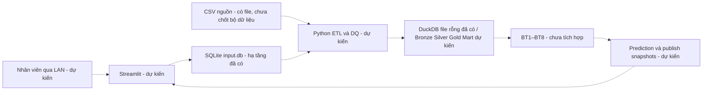

# Rohlik Decision Hub — Living Setup Tutorial & Technical Handover

Nguồn hướng dẫn setup và vận hành chính của Data Engineering. Ngày cập nhật:
**18/10/2026 (Asia/Saigon)**. Đối tượng: thành viên mới dùng Windows 11 và PowerShell.
Chạy các lệnh từ **thư mục gốc repository**, trừ khi bước đó ghi khác.

**Trạng thái hiện tại:** môi trường Python/Git, SQLite và DuckDB Infrastructure đã hoàn thành.
DBeaver đã được người dùng xác nhận kết nối và kiểm tra thành công. Schema nghiệp vụ,
Warehouse, ETL, mô hình và giao diện chưa được triển khai trong repository này.
Không dùng tài liệu kế hoạch làm bằng chứng code đã chạy.

## Mục lục

1. [Project Overview](#phan-1)
2. [Prerequisites](#phan-2)
3. [Project Setup từ đầu](#phan-3)
4. [Dependency Installation](#phan-4)
5. [Project Folder Structure](#phan-5)
6. [Git & Repository Management](#phan-6)
7. [SQLite Database Setup](#phan-7)
   - [DuckDB Infrastructure Setup](#duckdb-infrastructure)
8. [Kết nối SQLite bằng DBeaver](#phan-8)
9. [Testing & Verification](#phan-9)
10. [Troubleshooting](#phan-10)
11. [Current Implementation Status](#phan-11)
12. [Future Implementation & Handover](#phan-12)
13. [Documentation Maintenance Policy](#maintenance)
14. [Changelog](#changelog)

<a id="phan-1"></a>
## PHẦN 1 – Project Overview

Rohlik Decision Hub hướng đến hỗ trợ quyết định cho vận hành hàng tươi: dự báo nhu cầu,
kế hoạch nhân sự/giao hàng, quản lý thiếu hàng, đặt hàng, khuyến mãi và tăng trưởng kho.
Data Engineering (DE) chịu trách nhiệm thống nhất nguồn, chất lượng và giao diện dữ liệu
giữa người nhập liệu, kho phân tích, thành viên ML và người xây Streamlit.

SQLite là database file phục vụ nhập liệu và transaction ngắn. DuckDB là công cụ phân
tích dự kiến cho Data Warehouse, phù hợp truy vấn tổng hợp theo batch. Cài thư viện
DuckDB không đồng nghĩa đã tạo Warehouse. Python sẽ thực hiện ETL và Data Quality;
hiện có hạ tầng SQLite và file DuckDB rỗng cùng module đọc/ghi/transaction.
Streamlit được chọn theo kế hoạch để cung cấp giao diện
Python nội bộ, giảm phần việc web cho nhóm; chưa có ứng dụng hoặc cơ chế phân quyền.



Các mũi tên nét đứt là luồng dự kiến. Người dùng LAN truy cập ứng dụng trên máy chủ;
file SQLite đặt trên ổ cục bộ máy chủ, không mở chung qua network share với WAL.
Hạn chế cùng máy của WAL được nêu trong [tài liệu SQLite](https://sqlite.org/wal.html).
Pipeline dự kiến chạy batch thủ công bởi DE, chưa có scheduler hay lệnh pipeline.

| Vai trò | Trách nhiệm / nội dung bàn giao |
| --- | --- |
| E1 / Data Engineer | Môi trường, SQLite và DuckDB infrastructure, test, tài liệu; SQLite backup utility và hướng dẫn DuckDB offline backup. Sau này nguồn/ETL/DQ/Warehouse. Chưa ghi nhận tên người tiếp nhận. |
| Thành viên ML BT1–BT8 | Xác nhận input, target, grain, preprocessing, output và cách chạy qua Data Contract; tự phát triển mô hình. |
| Thành viên Streamlit | Sau khi chốt schema/quyền, dùng module SQLite và dữ liệu xuất đã thống nhất để xây UI. |
| Trưởng nhóm / chủ dự án | Chốt phạm vi, phân công, quyền truy cập và nghiệm thu các giai đoạn. |

Định hướng BT từ tài liệu Rohlik v3: BT1 dự báo đơn; BT2 nhân sự/tài xế; BT3 nhu cầu
bị mất; BT4 nhu cầu SKU; BT5 hiệu quả giảm giá; BT6 lượng đặt; BT7 markdown hàng cận hạn;
BT8 tăng trưởng kho mới. Đây là **REFERENCE_ONLY**, chưa xác nhận input/output thực tế.
Xem [kế hoạch v3](../Rohlik_Decision_Hub_Huong_dan_thuc_hien_v3.md) và
[mẫu Data Contract](data_contract_template.md). Tài liệu v3 nhắc bộ mã chạy thật và 14
bảng nguồn, nhưng không chứng minh repository hiện tại chứa những thành phần đó.

Gói bàn giao hiện có gồm source SQLite/DuckDB, 28 ca kiểm thử (14 mỗi engine), hướng dẫn này,
[SQLite Setup](sqlite_setup.md), [DuckDB Setup](duckdb_setup.md), template và tám contract đang chờ xác nhận.
CSV/database/backup phải bàn giao riêng qua kênh được nhóm phê duyệt, không qua Git.

- [ ] Người nhận phân biệt được code đã có và luồng dự kiến.
- [ ] Đã nhận source đầy đủ, thông tin người phụ trách và quyền truy cập cần thiết.

<a id="phan-2"></a>
## PHẦN 2 – Prerequisites

| Công cụ | Mức cần thiết | Cài đặt và xác minh |
| --- | --- | --- |
| Python 3.13 64-bit | Bắt buộc | Tải bản Windows phù hợp từ [Python.org](https://www.python.org/downloads/windows/), chạy installer. Kiểm tra đúng nhánh 3.13 và kiến trúc 64-bit ở phần 3. |
| Git for Windows | Bắt buộc với clone/commit/pull | Tải từ [Git chính thức](https://git-scm.com/install/windows), chạy installer rồi mở lại terminal; kiểm tra `git --version`. Nhận ZIP có thể chạy code nhưng cần Git để làm việc nhóm. |
| VS Code | Dùng cho quy trình IDE này; runtime không bắt buộc | Tải [VS Code](https://code.visualstudio.com/download), chọn Windows phù hợp, cài rồi mở thư mục dự án. |
| Python Extension của Microsoft | Cần cho quy trình Python trong VS Code | Extensions → tìm **Python**, publisher Microsoft, cài extension [ms-python.python](https://marketplace.visualstudio.com/items?itemName=ms-python.python). |
| DBeaver Community | Tùy chọn để xem DB; cần nếu nghiệm thu bằng UI | Cài từ [DBeaver Community](https://dbeaver.io/download/), tạo kết nối ở phần 8. Python không phụ thuộc DBeaver. |
| Codex | Tùy chọn | Theo [OpenAI Docs: Codex IDE](https://learn.chatgpt.com/docs/codex/ide), cài Codex extension chính thức trong VS Code, mở sidebar và đăng nhập theo hướng dẫn. Không cần để chạy dự án. |

Không cần SQLite Server, Docker hoặc cài gói `sqlite3` bằng pip: module này đi cùng
Python. Có mạng để tải dependencies/JDBC; có quyền đọc/ghi thư mục dự án.
Codex chỉ hỗ trợ phát triển; vẫn phải review thay đổi và chạy kiểm thử.

Các link chính thức đã được đối chiếu ngày 18/10/2026. Phiên bản ở phần 9 là snapshot
máy hiện tại, không khẳng định đó là bản mới nhất. Nếu trang tải không có installer
đúng patch Python, thống nhất bản 3.13 hỗ trợ Windows rồi chạy lại toàn bộ kiểm tra.

- [ ] Python 3.13 64-bit và Git chạy được từ terminal hoặc đường dẫn đã xác minh.
- [ ] VS Code và extension Python đã sẵn sàng nếu dùng quy trình IDE.

<a id="phan-3"></a>
## PHẦN 3 – Project Setup từ đầu

### 3.1 Nhận source

Repository hiện chỉ xác minh có initial commit `a16ceb4` —
`chore: initialize Rohlik project environment`; `git remote -v` hiện không có output.
Source SQLite/DuckDB và các tài liệu còn có file chưa commit. Vì vậy **chưa có URL GitHub
đã xác minh, chưa thể khẳng định clone sẽ nhận đủ code**.

Sau khi người phụ trách đã commit/push source và cung cấp URL, dùng:

```powershell
$repoUrl = Read-Host 'Nhap URL GitHub do nguoi phu trach cung cap'
Set-Location -LiteralPath "$env:USERPROFILE\Documents"
git clone $repoUrl rohlik-data-warehouse
Set-Location -LiteralPath .\rohlik-data-warehouse
```

Kỳ vọng có `requirements.txt`, `src/init_sqlite.py`, `src/init_duckdb.py`, `src/db/`, `tests/test_sqlite.py`, `tests/test_duckdb.py`
và `docs/setup_tutorial.md`. Nếu clone thất bại, kiểm tra URL/quyền và thư mục đích
đã tồn tại; không xoá thư mục đang chứa dữ liệu để thử lại.

Nếu chưa có remote, nhận bản source từ người bàn giao rồi giải nén vào thư mục mới,
không ghi đè workspace cũ. Không mang `.venv`, secrets hoặc database đang mở sang máy
khác bằng cách copy. Nhận dữ liệu riêng hoặc backup nhất quán nếu cần. ZIP có thể
không có `.git`; yêu cầu repository chính thức trước khi dùng quy trình Git nhóm.

### 3.2 Mở VS Code và PowerShell

Trong VS Code chọn **File → Open Folder**, mở root repository, chọn
**Terminal → New Terminal**, dùng PowerShell. Nếu lệnh `code` có trong PATH:

```powershell
code .
Get-Location
Test-Path -LiteralPath .\requirements.txt
```

Kỳ vọng terminal ở root, `Test-Path` trả `True`. Nếu `code` không được nhận, dùng menu
Open Folder. Trên máy bàn giao root là `C:\Users\win11\Documents\rohlik-data-warehouse`;
máy mới dùng vị trí thực tế của mình.

### 3.3 Xác định Python và tạo `.venv`

```powershell
py -3.13 --version
```

Kỳ vọng `Python 3.13.x`. Nếu `py` không tìm được Python (đã từng gặp trên máy hiện tại),
kiểm tra vị trí cài đặt. Với installer cài theo user ở vị trí mặc định:

```powershell
$python313 = Join-Path $env:LOCALAPPDATA 'Programs\Python\Python313\python.exe'
Test-Path -LiteralPath $python313
& $python313 --version
```

Nếu không có file, dùng đường dẫn Python 3.13 thực tế từ installer; không dùng nhầm
alias Microsoft Store hoặc một Python 3.15 khác trong PATH.

**Máy mới chưa có `.venv`:** chỉ chọn một trong hai cách tạo sau.

```powershell
py -3.13 -m venv .venv
```

Hoặc, nếu `$python313` ở trên đã được kiểm tra:

```powershell
& $python313 -m venv .venv
```

**Máy có `.venv` cũ trỏ Python 3.15 hoặc bị lỗi:** xem cấu hình trước.

```powershell
Get-Content -LiteralPath .\.venv\pyvenv.cfg
```

Đóng terminal đã activate, dừng tiến trình dùng `.venv`, mở PowerShell mới tại root.
Giữ nguyên môi trường cũ bằng cách đổi tên riêng thư mục `.venv`, không xoá:

```powershell
$projectRoot = (Get-Location).Path
$oldVenv = (Resolve-Path -LiteralPath .\.venv -ErrorAction Stop).Path
if ($oldVenv -ne (Join-Path $projectRoot '.venv')) { throw 'Sai thu muc .venv' }
$savedVenvName = '.venv-old-' + [guid]::NewGuid().ToString('N')
Rename-Item -LiteralPath $oldVenv -NewName $savedVenvName -ErrorAction Stop
```

Sau đó tạo `.venv` mới bằng Python 3.13 như trên và cài lại dependencies. Đây là
hướng dẫn thao tác thủ công, chưa được chạy trên môi trường hiện tại vì không cần
thay môi trường đang tốt. Chỉ đổi tên thư mục môi trường đã xác minh nằm ở root;
không chạm `src`, CSV hoặc `data/input.db`. Nếu ai đã lưu code/data trong `.venv`,
giữ lại để lấy ra trước. Không stage `.venv-old-*`: quy tắc `.venv/` không bao phủ tên đó.
Chưa cần xoá môi trường cũ; venv đổi tên không dùng để chạy lại, chỉ để giữ đối chiếu.

### 3.4 Activate và chọn interpreter

```powershell
.\.venv\Scripts\Activate.ps1
```

Kỳ vọng prompt có `(.venv)`. Nếu bị policy chặn, dùng trực tiếp đường dẫn Python
trong `.venv` cho mọi lệnh dưới đây; không cần đổi execution policy của toàn máy.
Trong VS Code: **Ctrl+Shift+P → Python: Select Interpreter → Enter interpreter path**,
chọn `.venv\Scripts\python.exe` của repository này. Xem thêm
[Python trong VS Code](https://code.visualstudio.com/docs/languages/python/).

```powershell
.\.venv\Scripts\python.exe --version
.\.venv\Scripts\python.exe -c "import sys, struct; print(sys.executable); print('venv:', sys.prefix != sys.base_prefix); print('bits:', struct.calcsize('P') * 8)"
```

Kỳ vọng Python 3.13.x, executable nằm trong `.venv` của dự án, `venv: True`, `bits: 64`.
Nếu khác, dừng cài dependencies và sửa interpreter trước.

- [ ] Nhận đủ source; root đúng; `.venv` dùng Python 3.13 64-bit.
- [ ] VS Code và các lệnh terminal dùng đúng interpreter.

<a id="phan-4"></a>
## PHẦN 4 – Dependency Installation

Các lệnh cài đặt dành cho máy cần setup; không cần nâng cấp máy đã nghiệm thu chỉ
để đọc tutorial. `requirements.txt` hiện **không pin phiên bản**, nên máy cài mới có
thể nhận phiên bản khác snapshot phần 9. Chưa có lockfile tái lập chính xác môi trường.

| Bước | Mục đích / kỳ vọng | Nếu thất bại |
| --- | --- | --- |
| 1. Kiểm tra pip | Output chỉ tới `.venv`, Python 3.13 | Sửa interpreter; nếu thiếu pip dùng lệnh ensurepip bên dưới. |
| 2. Nâng pip | pip nâng thành công hoặc đã hiện hành | Kiểm tra mạng/proxy/quyền; không chuyển sang pip global. |
| 3. DuckDB wheel | Cài binary wheel tương thích, không build C++ | Kiểm tra Python 3.13 64-bit và package index; không chuyển sang build source ngoài phạm vi. |
| 4. Requirements | Cài thành công hoặc already satisfied | Đọc tên gói lỗi, kiểm tra mạng và phiên bản Python. |
| 5. Import | `All imports OK` | Cài lại requirements trong đúng `.venv`; đối chiếu tên module `yaml`. |
| 6. pip check | `No broken requirements found.` | Giải quyết dependency conflict trước khi nghiệm thu; không bỏ qua lỗi. |
| 7. Streamlit version | In phiên bản, hiện tại 1.66.0 | Kiểm tra cài đặt trong `.venv`; chưa cần chạy server. |

**Bước 1 – pip**

```powershell
.\.venv\Scripts\python.exe -m pip --version
```

Chỉ khi pip thiếu:

```powershell
.\.venv\Scripts\python.exe -m ensurepip --upgrade
```

**Bước 2 – nâng pip**

```powershell
.\.venv\Scripts\python.exe -m pip install --upgrade pip
```

**Bước 3 – cài DuckDB bằng binary wheel**

```powershell
.\.venv\Scripts\python.exe -m pip install --only-binary=:all: duckdb
```

**Bước 4 – cài dependencies của repository**

```powershell
.\.venv\Scripts\python.exe -m pip install -r requirements.txt
```

**Bước 5–7 – xác minh**

```powershell
.\.venv\Scripts\python.exe -c "import duckdb, pandas, pyarrow, yaml, streamlit, pydantic, pytest; print('All imports OK')"
.\.venv\Scripts\python.exe -m pip check
.\.venv\Scripts\python.exe -m streamlit --version
```

| Thư viện | Vai trò |
| --- | --- |
| DuckDB | Engine phân tích/kho dữ liệu ở giai đoạn sau. |
| Pandas | Thao tác dữ liệu dạng bảng. |
| PyArrow | Dữ liệu dạng cột và trao đổi Arrow/Parquet. |
| PyYAML | Đọc cấu hình YAML; import bằng tên `yaml`. |
| Pydantic | Kiểm tra cấu trúc/kiểu dữ liệu. |
| Streamlit | Giao diện nội bộ dự kiến. |
| Pytest | Chạy test tự động. |

Ví dụ sự cố setup đã được người bàn giao nêu: `.venv` dùng Python 3.15 khiến pip
không tìm được DuckDB binary wheel tương thích (`No matching distribution found`).
Không tái hiện lỗi này trong lần viết tài liệu; không khẳng định mọi phiên bản
DuckDB đều thiếu wheel cho 3.15. Cách xử lý cho dự án này là dùng Python 3.13 64-bit,
tạo lại venv theo phần 3, rồi cài wheel. Nếu vẫn lỗi, kiểm tra proxy/index và lưu log.

- [ ] Imports, pip check và Streamlit version thành công trên máy nhận.

<a id="phan-5"></a>
## PHẦN 5 – Project Folder Structure

Cây rút gọn từ workspace ngày 18/10/2026, bỏ cache và không liệt kê toàn bộ file nguồn:

```text
rohlik-data-warehouse/
├── .git/                         # repository hiện tại; ZIP có thể không có
├── .venv/                        # môi trường cục bộ, không bàn giao nguyên thư mục
├── config/                       # đang trống
├── data/
│   ├── input.db                  # SQLite đã khởi tạo, chưa có bảng
│   ├── raw/
│   │   ├── orders/               # CSV đã có
│   │   └── sales/                # CSV đã có
│   ├── warehouse/
│   │   └── rohlik.duckdb          # file DuckDB rỗng, chưa có bảng nghiệp vụ
│   ├── published/                # trống
│   ├── backups/                  # hiện có một SQLite backup
│   └── exports/                  # thư mục đầu ra dự kiến
├── src/
│   ├── __init__.py
│   ├── init_sqlite.py
│   ├── init_duckdb.py
│   ├── db/
│   │   ├── __init__.py
│   │   ├── sqlite.py
│   │   ├── duckdb.py
│   │   └── backup.py
│   ├── models/                   # trống
│   └── services/                 # trống
├── tests/
│   ├── test_sqlite.py
│   └── test_duckdb.py
├── docs/
│   ├── setup_tutorial.md
│   ├── sqlite_setup.md
│   ├── duckdb_setup.md
│   ├── data_contract_template.md
│   └── contracts/                # BT1.md … BT8.md
├── logs/                         # trống
├── .gitignore
├── README.md
└── requirements.txt
```

Root còn có CSV và tài liệu kế hoạch MD/DOCX/TSV. File tồn tại không có nghĩa đã được
chốt làm nguồn chính thức. Không chỉnh sửa CSV gốc trong quá trình setup.

| Thư mục | Mục đích / tình trạng |
| --- | --- |
| `config/` | Dự kiến cấu hình; chưa có Data Source Registry hoặc cấu hình pipeline. |
| `data/raw/` | CSV nguồn cục bộ; bảo toàn bản gốc. |
| `data/warehouse/` | Đã có `rohlik.duckdb` rỗng; chưa triển khai Warehouse nghiệp vụ. |
| `data/published/` | Dự kiến snapshot cho bên tiêu thụ, chưa có output. |
| `data/backups/` | Snapshot SQLite bằng Backup API, không ghi đè bản cũ. |
| `src/`, `src/db/` | SQLite và DuckDB infrastructure cùng CLI; chưa có ETL. |
| `src/models/`, `src/services/` | Chưa có implementation; không có model runner hay Data Entry API. |
| `tests/` | 14 ca SQLite + 14 ca DuckDB; mọi ghi test đều vào đường dẫn tạm. |
| `docs/` | Setup, contract và bàn giao. |
| `logs/` | Dự kiến log vận hành; chưa có logging pipeline. |

Git không lưu thư mục trống; clone mới có thể thiếu các thư mục này. SQLite/DuckDB init
tự tạo thư mục cha và backup tự tạo thư mục backup. Không cần dựng Warehouse rỗng.
CSV, database và output được ignore để tránh commit dữ liệu lớn/nhạy cảm và snapshot
không nhất quán. Secrets phải ở ngoài source; `.gitignore` không thay thế review và
không loại file đã được theo dõi khỏi lịch sử.

- [ ] Kiểm tra cấu trúc nhận được, không suy diễn tính năng từ tên thư mục trống.

<a id="phan-6"></a>
## PHẦN 6 – Git & Repository Management

### 6.1 Kiểm tra trước khi thay đổi

```powershell
git --version
git status --short
git log -1 --oneline
git remote -v
git check-ignore -v -- .venv/Scripts/python.exe data/raw/orders/train.csv data/input.db data/input.db-wal data/input.db-shm data/backups/probe.db .env .streamlit/secrets.toml
git ls-files -- '*.csv' '*.db' '*.db-wal' '*.db-shm' 'data/backups/*'
```

Kỳ vọng phiên bản Git hiện ra; status thể hiện đúng công việc của mình. `??` là file
chưa theo dõi, `M` là file đã sửa. `check-ignore` in rule cho các đường dẫn trên
(probe không cần tồn tại). `ls-files` cuối phải trống. Remote có thể chưa có và không
được tự suy đoán URL. Initial commit hiện được xác minh là `a16ceb4`.

### 6.2 Commit có review — chỉ người bàn giao thực hiện khi sẵn sàng

Kiểm tra diff, secrets và dữ liệu trước; stage từng đường dẫn đã đọc. Ví dụ chỉ commit
hai file tài liệu khi source SQLite đã được bàn giao trong commit riêng:

```powershell
git diff -- README.md
git add -- README.md docs/setup_tutorial.md
git diff --cached --name-only
git diff --cached
git commit -m "docs: add setup tutorial and technical handover"
```

Nếu source SQLite vẫn chưa commit, người phụ trách cần review/stage cả các file
source và test phù hợp trước khi người nhận clone. Không dùng `git add .` mù quáng.
Nếu stage nhầm, bỏ stage bằng `git restore --staged -- <duong-dan>` với đường dẫn thực tế;
lệnh này không xoá bản làm việc. Nếu chưa có identity, đặt tên/email của chính mình
trong repository, không dùng danh tính của người bàn giao:

```powershell
$gitName = Read-Host 'Ten hien thi Git cua ban'
$gitEmail = Read-Host 'Email Git cua ban'
git config user.name $gitName
git config user.email $gitEmail
```

### 6.3 Remote, push và pull

Chỉ thêm remote khi chủ repository đã tạo GitHub repo và cung cấp URL đúng.
Kiểm tra `git remote -v` trước; lệnh add chỉ dành cho trường hợp chưa có `origin`:

```powershell
$repoUrl = Read-Host 'URL GitHub da duoc xac nhan'
git remote add origin $repoUrl
git remote -v
```

Sau khi review và commit, kiểm tra nhánh rồi push nhánh hiện tại:

```powershell
git branch --show-current
git push -u origin HEAD
```

Kỳ vọng remote nhận commit; cần quyền GitHub và đăng nhập qua cơ chế Git hỗ trợ,
không ghi token trong URL hoặc tài liệu. Nếu remote đã có lịch sử khác hoặc push bị
reject, kiểm tra và thống nhất cách hợp nhất; không force-push.

Trước khi nhận code mới, bảo đảm thay đổi cục bộ đã được lưu/commit phù hợp và working
tree sạch, nhánh có upstream đúng:

```powershell
git status --short
git pull --ff-only
```

Nếu không fast-forward được, dừng và xử lý nhánh với nhóm; không reset xoá công việc.
Các lệnh commit/push/pull ở đây là hướng dẫn, **không được chạy trong lần biên soạn này**.

- [ ] Chỉ stage source/tài liệu đã review; không dữ liệu hoặc secrets.
- [ ] URL, quyền GitHub và nhánh bàn giao được xác nhận trước khi push/clone.

<a id="phan-7"></a>
## PHẦN 7 – SQLite Database Setup

### 7.1 Khởi tạo và kiểm tra

`sqlite3` là module Python mở file database trực tiếp, không cần server riêng.
`data/input.db` sẽ lưu input nhân viên sau khi schema được duyệt; hiện chưa có bảng.
Implementation: [sqlite.py](../src/db/sqlite.py),
[init_sqlite.py](../src/init_sqlite.py), [backup.py](../src/db/backup.py).

```powershell
.\.venv\Scripts\python.exe -m src.init_sqlite
```

Kỳ vọng `SUCCESS: SQLite initialized and verified`, đường dẫn tuyệt đối và:

```text
sqlite_version: 3.50.4
journal_mode: wal
busy_timeout: 5000
foreign_keys: 1
```

Phiên bản có thể khác trên máy mới; phải xác minh và ghi nhận. CLI tạo file nếu thiếu,
không xoá/ghi đè/tái tạo file có sẵn và không tạo bảng. Kiểm tra journal mode trước
khi bật WAL, không chuyển chế độ mỗi lần mở connection. Đóng các ứng dụng kết nối
trước lần đầu cấu hình WAL. Nếu `FAILED`, kiểm tra đường dẫn/quyền/lock, không xoá DB.
Tham số `--database PATH` hỗ trợ đường dẫn riêng; đường dẫn tương đối tính từ root
theo vị trí module, độc lập với cwd. Để Python tìm được `src` khi chạy `-m`, vẫn chạy
lệnh từ root repository.

Kiểm tra lại settings và schema, không thêm record:

```powershell
@'
from src.db.sqlite import connection, verify_connection
with connection() as conn:
    print(verify_connection(conn))
    print(conn.execute("SELECT 42").fetchone())
    print(conn.execute("SELECT name FROM sqlite_master WHERE type=?", ("table",)).fetchall())
'@ | .\.venv\Scripts\python.exe -
```

Kỳ vọng settings đúng, `(42,)`, danh sách bảng `[]` ở giai đoạn hiện tại.
Khi schema được triển khai sau này phải cập nhật kỳ vọng này.

### 7.2 Connection và transaction cho backend/Streamlit

| API thực tế | Hành vi |
| --- | --- |
| `connection(path=DEFAULT_DATABASE)` | Mở file đã có, mode=rw, autocommit, timeout 5 giây, foreign keys bật; luôn đóng khi rời context. Không tự tạo nguồn thiếu, không đổi WAL. |
| `transaction(path=DEFAULT_DATABASE)` | Connection riêng, BEGIN tường minh; commit khi thành công, rollback khi có exception rồi phát lại lỗi. |
| `verify_connection(conn)` | Đọc settings, raise RuntimeError nếu không đúng WAL / 5000 / 1. |
| `initialize_database(path=DEFAULT_DATABASE)` | Tạo nếu thiếu, cấu hình/xác minh; không tạo schema. |

WAL cho phép reader đọc trong khi writer đang ghi, nhưng chỉ có một writer tại một
thời điểm. `busy_timeout=5000` chờ lock tối đa 5 giây; không đảm bảo ghi luôn thành công.
Foreign keys là cấu hình trên từng connection, chỉ có tác dụng với ràng buộc đã khai báo.

Mỗi thao tác Streamlit phải mở context riêng, không cache/chia sẻ connection toàn cục
giữa nhiều phiên. Giữ transaction ngắn, không chờ người dùng bên trong transaction.
Truyền giá trị qua placeholders, không nối chuỗi SQL từ input.

```python
from src.db.sqlite import connection

with connection() as conn:
    row = conn.execute("SELECT ? AS value", (42,)).fetchone()
```

Sau khi schema được duyệt, đặt các câu ghi có tham số trong `with transaction() as conn:`.
Không gọi commit/rollback hoặc `executescript` bên trong context transaction vì có thể
phá phạm vi atomic. Hiện chưa có `save_record`, form, Data Entry API hay phân quyền.
Test kiểm chứng commit/rollback dùng bảng kỹ thuật trên **database tạm**, không DB thật.

### 7.3 Tests, backup và integrity

```powershell
.\.venv\Scripts\python.exe -m pytest -q
.\.venv\Scripts\python.exe -m src.db.backup
```

Kỳ vọng toàn bộ 28 passed (14 SQLite + 14 DuckDB); backup SQLite in `SUCCESS`, đường dẫn mới trong `data/backups/` và
`integrity_check=ok`. Backup dùng `sqlite3.Connection.backup`, bao gồm dữ liệu đã
commit trong WAL, tên có timestamp UTC và UUID; không ghi đè backup trước.
Chọn backup cụ thể để kiểm tra (nhập đường dẫn thực tế vừa được in):

```powershell
$backupFile = Read-Host 'Duong dan file backup can kiem tra'
.\.venv\Scripts\python.exe -m src.db.backup --check $backupFile
```

Kiểm tra database hiện tại chỉ đọc:

```powershell
.\.venv\Scripts\python.exe -m src.db.backup --check data/input.db
```

Kỳ vọng `SUCCESS: integrity_check=ok`. Integrity xác minh cấu trúc SQLite, không chứng
minh logic nghiệp vụ đúng. Backup nằm cùng ổ không bảo vệ khỏi hỏng ổ; chính sách lưu
bản ngoài máy, thời hạn giữ và người chịu trách nhiệm vẫn cần nhóm thống nhất.

### 7.4 Khôi phục an toàn

**Chưa có restore CLI.** Test hiện có dùng Backup API để phục hồi vào file tạm và
đối chiếu record. Quy trình vận hành dưới đây là hướng dẫn dự kiến cho người quản trị,
chưa nghiệm thu phục hồi database thật:

1. Dừng mọi writer và đóng ứng dụng/DBeaver liên quan trước can thiệp DB thật.
2. Giữ nguyên nguồn lỗi và các file WAL/SHM đi kèm; không tự xoá hoặc ghi đè.
3. Chọn backup đã kiểm tra integrity. Nhờ người phụ trách phục hồi bằng Backup API
   vào **file mới**, kiểm tra integrity, schema và số liệu cần thiết trên bản đó.
4. Chỉ thay database đang vận hành sau khi chủ dữ liệu phê duyệt, có snapshot hiện
   trạng và kế hoạch quay lui; không tự động thay `data/input.db`.
5. Mở lại qua module ứng dụng, kiểm tra WAL/FK/timeout rồi chạy kiểm tra nghiệp vụ
   được duyệt. Không giả định bản phục hồi giữ đúng settings cho mọi client.

Không copy riêng `.db` khi WAL đang hoạt động; có thể bỏ sót commit. Không đổi tên
database thật hoặc di chuyển WAL/SHM khi còn kết nối. Chi tiết thêm ở [SQLite Setup](sqlite_setup.md).

- [ ] Init và PRAGMA đạt; test không ghi record vào DB thật.
- [ ] Backup mới có integrity `ok`; có kế hoạch restore riêng được duyệt nếu cần.

<a id="duckdb-infrastructure"></a>
### 7.5 DuckDB Infrastructure Setup — đã triển khai

Phạm vi là database rỗng và quản lý kết nối, không phải Warehouse nghiệp vụ.
Cấu hình `DEFAULT_DATABASE` tại `src/db/duckdb.py` trỏ tới
`data/warehouse/rohlik.duckdb` qua `pathlib`, độc lập với cwd. Từ root chạy:

```powershell
.\.venv\Scripts\python.exe -m src.init_duckdb
.\.venv\Scripts\python.exe -m pytest tests/test_duckdb.py -q
```

Kỳ vọng CLI `SUCCESS`, `duckdb_version: v1.5.6`, `created: True` lần đầu hoặc
`False` khi file đã có; 14 ca DuckDB PASS. File đã có chỉ được xác minh read-only,
không tạo bảng, không xoá/ghi đè dữ liệu. File lỗi báo `FAILED`/exit 1.

```powershell
@'
from src.db.duckdb import connection
with connection() as conn:
    print(conn.execute("SELECT 42").fetchone())
    print(conn.execute("SHOW TABLES").fetchall())
'@ | .\.venv\Scripts\python.exe -
```

Kỳ vọng `(42,)`, `[]` hiện tại. Module hỗ trợ `connection(path, read_only=True)`
mặc định đọc, `read_only=False` để ghi, luôn đóng connection. `transaction(path)`
mở writer riêng, BEGIN/commit/rollback theo kết quả context; không chia sẻ writer
giữa các phiên Streamlit. File thiếu phải init riêng, connection không tự tạo.

Trong mô hình file embedded hiện tại, DE giữ một tiến trình ghi; đóng kết nối ghi
trước khi mở read-only, chạy thao tác tuần tự. Streamlit dự kiến đọc published
snapshots, không giữ file Warehouse đang ghi. Chưa có publisher hoặc UI.

Backup DuckDB hiện là hướng dẫn offline: dừng mọi client/tác vụ có thể mở file,
đóng sạch writer, không copy nếu còn WAL, copy sang tên mới rồi mở bản backup
read-only để đối chiếu. Không dùng utility SQLite `src.db.backup` cho DuckDB.
Ví dụ an toàn, điều kiện bảo trì và xử lý lock ở [DuckDB Setup](duckdb_setup.md).
Chưa có DuckDB backup/restore CLI; copy offline đã test trên database tạm, chưa
backup/restore database dự án. Không áp dụng SQLite `PRAGMA integrity_check` cho DuckDB.

- [x] Init mới/chạy lại, query, read-only, commit/rollback và chuỗi thao tác tuần tự đã test.
- [x] Database dự án không có bảng; `.duckdb`, WAL và dữ liệu phát sinh được Git ignore.
- [ ] Setup sạch và phục hồi vận hành thật chưa nghiệm thu; schema/ETL chờ contracts.

<a id="phan-8"></a>
## PHẦN 8 – Kết nối SQLite bằng DBeaver

**VERIFIED theo xác nhận của người dùng:** DBeaver kết nối thành công,
`integrity_check=ok` và các kiểm tra còn lại thành công. Phiên bản DBeaver Community
26.2.2, SQLite JDBC Driver 3.53.4.0 do người dùng cung cấp; không tự đọc từ UI lần này.
Trên máy khác phải tự thực hiện và ghi nhận, không kế thừa trạng thái PASS.

Theo [hướng dẫn SQLite của DBeaver](https://dbeaver.com/docs/dbeaver/Database-driver-SQLite/):

1. Mở DBeaver Community.
2. Chọn **Database → New Database Connection**.
3. Chọn **SQLite → Next**.
4. Chọn file `data/input.db` của repository trong trường **Path**. Dùng đường dẫn
   tuyệt đối thực tế; không chọn nhầm file JDBC `.jar`.
5. Nếu được yêu cầu, tải SQLite JDBC Driver qua hộp thoại của DBeaver.
6. Nhấn **Test Connection**, xác nhận thành công; nếu lỗi xem phần 10.
7. Nhấn **Finish**.
8. Mở SQL Editor gắn với kết nối vừa tạo.
9. Đặt con trỏ tại từng câu, dùng **Ctrl+Enter** để chạy (key binding mặc định).

```sql
SELECT sqlite_version();
PRAGMA journal_mode;
PRAGMA integrity_check;
```

Kỳ vọng lần lượt là phiên bản SQLite của driver, `wal`, `ok`. DBeaver dùng SQLite
qua JDBC còn Python dùng thư viện đi kèm Python; hai giá trị version có thể khác.
Số phiên bản driver không thay thế kết quả truy vấn `sqlite_version()`.

Trong Database Navigator mở kết nối → Tables → Refresh. Hiện chưa có bảng là đúng.
Để xem schema qua SQL:

```sql
SELECT name, type, sql FROM sqlite_master ORDER BY type, name;
```

Nếu dùng DBeaver để ghi sau này, cấu hình từng connection ngoài transaction:

```sql
PRAGMA busy_timeout=5000;
PRAGMA foreign_keys=ON;
PRAGMA busy_timeout;
PRAGMA foreign_keys;
```

Kỳ vọng 5000 và 1. Python không cấu hình hộ connection của JDBC. Sau reconnect phải
kiểm tra lại; không đổi journal mode tùy tiện khi ứng dụng đang mở.

**Khác biệt tài liệu cũ:** `sqlite_setup.md` vẫn ghi chưa xác minh UI vì được viết
trước xác nhận của người dùng. Trạng thái mới tại tutorial này là VERIFIED theo người
dùng; không tuyên bố Codex đã tự thao tác DBeaver hoặc có ảnh chụp màn hình.

- [ ] Máy nhận Test Connection thành công và chạy đủ ba câu kiểm tra.

<a id="phan-9"></a>
## PHẦN 9 – Testing & Verification

### 9.1 Snapshot máy bàn giao

Kiểm tra lại ngày **18/10/2026**, trên Windows hiện tại, không phải môi trường sạch:

| Thành phần | Kết quả / nguồn bằng chứng |
| --- | --- |
| Python | 3.13.15, 64-bit; executable trong `.venv`, venv=True — chạy thực tế. |
| Git | 2.54.0.windows.1; initial commit a16ceb4; không remote — chạy thực tế. |
| DuckDB / Pandas / PyArrow | 1.5.6 / 3.0.6 / 26.0.0 — đọc package metadata. |
| PyYAML / Pydantic | 6.0.3 / 2.14.1 — đọc package metadata. |
| Streamlit / Pytest / pip | 1.66.0 / 9.1.1 / 26.2.1 — chạy thực tế. |
| Dependency health | `No broken requirements found.` |
| SQLite Python | 3.50.4; wal / 5000 / foreign_keys=1 — đọc connection mới. |
| DuckDB Infrastructure | v1.5.6; init mới và chạy lại SUCCESS; SELECT 42, SHOW TABLES=[]; database rỗng. |
| Database thật | integrity=ok; danh sách bảng rỗng — truy vấn, không sửa schema. |
| Backup hiện có | Một file, integrity=ok — kiểm tra lại, không tạo backup mới lần này. |
| Pytest | **28 passed, 0 failed** sau khi thêm DuckDB: 14 SQLite + 14 DuckDB, chạy thực tế trong 8.73 giây; thời gian chỉ tham khảo. |
| Git ignore | DB/WAL/SHM/backups/venv/secrets được ignore; không CSV/DB/backup đang tracked. |
| DBeaver | VERIFIED theo người dùng; 26.2.2 / JDBC 3.53.4.0 là thông tin người dùng. |

Các test ở [test_sqlite.py](../tests/test_sqlite.py) bao phủ: tạo DB không bảng, query
tham số và đóng connection, WAL tồn tại qua connection mới, FK/timeout từng connection,
enforce FK, commit, rollback cả DDL, init lặp không mất record, nhiều connection với
reader trong lúc ghi, backup dữ liệu còn ở WAL, backup không ghi đè, restore tạm,
nguồn thiếu, file hỏng không bị thay thế, đường dẫn không phụ thuộc cwd và CLI SUCCESS/FAILED.
Đó là 14 test functions; một test có thể xác minh nhiều hành vi.

Các ca trong [test_duckdb.py](../tests/test_duckdb.py) kiểm tra vị trí file/schema rỗng,
query tham số/đóng connection, read-only sau writer và từ chối ghi, commit/rollback,
init lặp giữ dữ liệu và bytes, chuỗi thao tác tuần tự, nguồn thiếu (cả hai chế độ),
file hỏng không bị thay thế, đường dẫn độc lập cwd, backup offline và CLI.
Tổng 14 ca DuckDB, chỉ dùng database tạm; không nạp CSV hoặc ghi bảng vào file dự án.

### 9.2 Checklist trên máy nhận

Thực hiện theo thứ tự phần 3 → 4 → 6 → 7 → 8, lưu output và thời điểm xác minh:

- [ ] Có source đầy đủ và quyền Git; interpreter Python 3.13 64-bit đúng.
- [ ] Import tất cả thư viện thành công; `pip check` sạch; version được ghi nhận.
- [ ] `git check-ignore` đúng; `git ls-files` không chứa dữ liệu/secrets.
- [ ] CLI init SUCCESS, đường dẫn đúng, WAL/FK/timeout đúng.
- [ ] DuckDB init SUCCESS, SELECT 42 đúng, SHOW TABLES rỗng hiện tại; chạy thao tác tuần tự theo phần 7.5.
- [ ] `pytest -q`: toàn bộ test PASS, không test ghi vào DB thật.
- [ ] Integrity database và backup đều ok; đã ghi lại tên backup.
- [ ] Database hiện chưa có bảng nghiệp vụ; không chèn dữ liệu để thử UI.
- [ ] DBeaver Test Connection và SQL checks thành công trên máy nhận.
- [ ] Các khác biệt phiên bản có giải thích, lỗi được xử lý trước ký bàn giao.

**Chưa làm trong lần này:** dựng môi trường sạch, tải/cài lại gói, cấu hình remote,
push/pull GitHub, phục hồi DB thật hoặc triển khai LAN. Lệnh cài đặt/Git là hướng dẫn,
không phải bằng chứng đã chạy trên máy mới. Một lỗi quoting PowerShell trong lệnh
kiểm tra ad hoc đã được sửa bằng here-string; lỗi output Unicode được tránh khi đọc
tiếng Việt bằng PowerShell UTF-8. Không có lỗi pytest hay sửa source trong lần này.

<a id="phan-10"></a>
## PHẦN 10 – Troubleshooting

| Sự cố | Chẩn đoán và cách xử lý an toàn |
| --- | --- |
| Python không tìm thấy | Mở terminal mới sau cài; thử `py -3.13 --version`; kiểm tra đường dẫn installer như phần 3. Không dùng nhầm alias Store. |
| `.venv` trỏ sai Python | Xem `pyvenv.cfg` và `sys.executable`; giữ venv cũ bằng đổi tên có kiểm tra đường dẫn, tạo mới bằng 3.13 rồi cài lại gói. Không xoá data. |
| Activate.ps1 bị chặn | Dùng trực tiếp `.\.venv\Scripts\python.exe`; không cần thay policy toàn máy. |
| VS Code chọn nhầm interpreter | Python: Select Interpreter → `.venv\Scripts\python.exe`; mở terminal mới, chạy lại phần 3.4. |
| pip không có DuckDB wheel | Kiểm tra Python 3.13 64-bit, pip/index/proxy; dùng `--only-binary=:all:`. Không tự build C++ hoặc đổi công nghệ. |
| Git thiếu identity | Đặt user.name/email của mình ở repository như phần 6; kiểm tra lại trước commit. |
| SQLite database locked | Commit/rollback transaction còn mở trong DBeaver, rút ngắn transaction; đóng connection trước bật WAL lần đầu. Timeout 5 giây không giải quyết writer giữ lock lâu. |
| DuckDB lock / cấu hình kết nối khác nhau | Dừng client khác, đóng writer trước read-only; một tiến trình DE ghi, chạy tuần tự. Không xoá WAL hoặc tạo đè file. Xem DuckDB Setup. |
| Có `-wal`, `-shm` | Đây là file vận hành WAL; có thể có hoặc biến mất sau khi đóng connection/checkpoint. Không xoá, copy tách rời hay commit chúng. Dùng Backup API. |
| DBeaver đòi JDBC | Tải qua hộp thoại driver chính thức, kiểm tra mạng/proxy. Python không cần driver này. |
| DBeaver không kết nối | Kiểm tra file DB đã init, Path trỏ đúng `.db`, quyền thư mục, JDBC và lock; chưa đánh PASS khi Test Connection còn lỗi. |
| Unable to open / readonly DB | Kiểm tra file và quyền ghi cả thư mục chứa WAL/SHM; để trên ổ cục bộ máy chủ. Không đổi sang thư mục nguồn khác tùy tiện. |
| File is not a database / integrity lỗi | Dừng ghi, giữ nguyên file và sidecars; điều tra, xác minh backup, xin duyệt trước phục hồi thật. |
| Git đã theo dõi dữ liệu | `.gitignore` không bỏ tracked file. Xác minh backup, review đường dẫn; có thể dùng `git rm --cached -- <duong-dan-thuc-te>` để bỏ khỏi index và giữ file cục bộ. Nếu đã push secrets, thu hồi secrets và phối hợp xử lý history; không tự rewrite lịch sử chung. |
| No module named src | Chạy `-m` tại root chứa `src`; không chạy từ `src/db`. |
| Output tiếng Việt lỗi encoding | Đọc Markdown bằng `Get-Content -Encoding UTF8`; khi pipe Python cần output Unicode, có thể dùng `python.exe -X utf8 -`. Không đổi nội dung dữ liệu để sửa lỗi hiển thị. |

Nếu chưa rõ nguyên nhân, lưu command, output đã loại secrets, phiên bản và file liên
quan để người phụ trách tái hiện. Không đánh PASS bằng cách bỏ qua test lỗi.

<a id="phan-11"></a>
## PHẦN 11 – Current Implementation Status

Trạng thái tính cho **repository này**, không suy đoán công việc trong máy/notebook
của thành viên khác. “COMPLETED” mô tả phạm vi hạ tầng đã có; bằng chứng theo phần 9.

| Hạng mục | Trạng thái | Căn cứ / giới hạn |
| --- | --- | --- |
| Python Setup | COMPLETED | 3.13.15 64-bit, `.venv` đã kiểm tra. |
| Dependencies | COMPLETED | Imports và pip check tốt; requirements chưa pin. |
| Git Setup | COMPLETED | Repo và initial commit có thật; remote/push GitHub chưa thiết lập. |
| SQLite Infrastructure | COMPLETED | Module/CLI/backup + 14 tests PASS. |
| DuckDB Infrastructure | COMPLETED | File rỗng, module đọc/ghi/transaction, CLI idempotent; 14 ca PASS. |
| DBeaver Connection | VERIFIED | Người dùng xác nhận kết nối/integrity và các kiểm tra thành công. |
| Data Contracts | WAITING FOR TEAM INPUT | Template và BT1–BT8 đều PENDING_CONFIRMATION; định hướng là REFERENCE_ONLY. |
| Data Source Registry | NOT IMPLEMENTED | Không tìm thấy file registry; `config/` trống. Metadata nguồn trong contract vẫn chờ xác nhận. |
| SQLite Business Schema | NOT IMPLEMENTED | `sqlite_master` không có bảng. |
| DuckDB Warehouse nghiệp vụ | NOT IMPLEMENTED | Có file DuckDB rỗng; chưa có schema/bảng hoặc dữ liệu nghiệp vụ. |
| Bronze / Silver / Gold / Mart | NOT IMPLEMENTED | Không có source pipeline hoặc output. |
| Model Integration | NOT IMPLEMENTED | `src/models/` trống; chưa có runner/contract tích hợp đã duyệt. |
| Streamlit Integration | NOT IMPLEMENTED | Chưa có app/form/auth; module DB mới sẵn sàng để tái sử dụng. |

<a id="phan-12"></a>
## PHẦN 12 – Future Implementation & Handover

**Roadmap, không phải lệnh triển khai ngay.** Chờ nghiệm thu trước giai đoạn tiếp theo.
Mỗi bước phải có người nhận trách nhiệm, đầu vào được duyệt và bằng chứng kiểm thử.

| Thứ tự dự kiến | Công việc | Điều kiện / đầu ra cần bàn giao |
| --- | --- | --- |
| 1 | Xác minh bộ dataset cuối cùng, Data Source Registry | Tên/nguồn/phiên bản/quyền truy cập, thời gian và chủ dữ liệu; không mặc định chỉ 6 CSV. |
| 2 | Data Dictionary và Data Contracts | BT1–BT8 xác nhận cột/target/key/grain/JOIN/preprocessing/output, người duyệt và bằng chứng. |
| 3 | SQLite Business Schema và Data Entry API | Schema, validation, transaction và quyền nghiệp vụ đã thống nhất; không tự thiết kế 14 bảng từ kế hoạch cũ. |
| 4 | DuckDB Source/Bronze | Nạp nguồn theo snapshot, có lineage và cách chạy batch tái lập. |
| 5 | Silver Data Cleaning | Quy tắc null/duplicate/type/JOIN đã duyệt, giữ khả năng truy vết nguồn. |
| 6 | Gold Data Warehouse | Mô hình dữ liệu và chỉ số thống nhất, kiểm tra tính đúng. |
| 7 | Data Mart BT1–BT8 | Input theo grain/key và lịch dữ liệu được từng thành viên xác nhận. |
| 8 | Data Quality | Quy tắc, ngưỡng, báo lỗi/quarantine; kiểm tra xuyên các tầng khi xây dựng. |
| 9 | Model Integration Contract | Phiên bản model/input/output, command, dependencies và evaluation; tránh data leakage. |
| 10 | Prediction outputs và publish snapshots | Schema/phiên bản, kiểm tra output, quy tắc công bố và snapshot nhất quán. |
| 11 | Streamlit Integration | UI, phân quyền, nhập liệu, đọc output theo contract, không chia sẻ connection toàn cục. |
| 12 | End-to-end tests | Nhập liệu → lưu → pipeline → mô hình → xuất → UI, chỉ kiểm thử khi luồng tồn tại. |
| 13 | Deployment LAN | Máy chủ/đường dẫn/quyền truy cập, cách khởi động, vận hành batch, backup ngoài máy và diễn tập restore. |

Người nhận cần bổ sung trước khi ký bàn giao đầy đủ: URL/nhánh/commit source hoàn chỉnh,
quyền GitHub; tên/liên hệ DE, ML, Streamlit và người duyệt; dataset cuối cùng và cách
nhận an toàn; contract đã xác nhận; bản dependencies tái lập nếu nhóm yêu cầu; máy LAN,
chính sách backup/retention và người được phép restore. Chưa có bằng chứng setup sạch.

- [ ] Chủ dự án nghiệm thu tài liệu và phạm vi đã có.
- [ ] Người nhận tự chạy checklist trên môi trường sạch, ghi lỗi/khác biệt và ký nhận.
- [ ] Chỉ bắt đầu roadmap sau khi giai đoạn tương ứng được giao và chốt đầu vào.

<a id="maintenance"></a>
## Documentation Maintenance Policy

1. Sau mỗi giai đoạn DE hoàn thành và được kiểm thử, cập nhật tutorial này trong cùng
   đợt thay đổi source; DE hoặc người tiếp nhận chịu trách nhiệm nội dung.
2. Không viết tính năng chưa hoàn thành như đã triển khai. Phân biệt trạng thái:
   **VERIFIED** (có kiểm tra và bằng chứng), **IMPLEMENTED_NOT_TESTED** (có code chưa
   thử), **PLANNED** (dự kiến), **BLOCKED** (chưa thể tiếp tục, ghi lý do và bên cần xử lý).
   PENDING_CONFIRMATION của contract là trạng thái thu thập, không chứng minh model chưa làm.
3. Mỗi phần mới cần điều kiện setup, command đúng với source, kết quả mong đợi,
   troubleshooting, checklist nghiệm thu và cách kiểm thử tái lập an toàn.
4. Đổi tên script/đường dẫn phải sửa các command và link cũ ở tutorial, README và tài
   liệu liên quan. Không để ví dụ gọi hàm không còn tồn tại.
5. Giữ lịch sử quan trọng; hướng dẫn lỗi thời chuyển sang mục migration khi cần,
   ghi phiên bản áp dụng và cách chuyển an toàn. Không xoá bằng chứng cũ để che khác biệt.
6. Changelog ở cuối: ngày theo Asia/Saigon, thay đổi, file/code liên quan, trạng thái
   xác minh và hạn chế. Nếu có commit chính thức, bổ sung hash và người xác minh.
7. Tính năng mới phải có checklist và test đúng phạm vi; ghi command, số PASS/FAIL,
   version input/output nếu có. Không lưu secrets hoặc record nhạy cảm trong log bàn giao.
8. Phân biệt test tự chạy, xác nhận của người dùng và hướng dẫn chưa thử. Máy hiện tại
   PASS không chứng minh máy mới PASS; không cài lại hệ thống đang tốt chỉ để đánh dấu sạch.
9. **Trước khi ký bàn giao cuối cùng, làm theo tutorial trên môi trường sạch** và
   lưu kết quả. Việc này chưa thực hiện trong lần biên soạn đầu; không đánh VERIFIED cho nó.
10. Không đưa mật khẩu, token, credentials hoặc dữ liệu nhạy cảm vào tutorial.

Khi yêu cầu **“Update Setup Tutorial”**: đọc code mới và diff, xác định phần bị ảnh
hưởng; cập nhật đúng các phần đó, giữ nội dung hữu ích, chạy kiểm tra an toàn tương
ứng rồi sửa status/checklist/changelog và link README nếu cần. Không tự triển khai
roadmap hoặc tự commit/push chỉ vì cập nhật tài liệu.

<a id="changelog"></a>
## Changelog

| Ngày | Thay đổi | File/code liên quan | Xác minh |
| --- | --- | --- | --- |
| 18/10/2026 | Tạo tutorial 12 phần, policy, quy trình bàn giao và phân biệt hiện trạng/roadmap; thêm link README. | `docs/setup_tutorial.md`, `README.md`; đối chiếu `src/db/sqlite.py`, `src/db/backup.py`, `src/init_sqlite.py`, `tests/test_sqlite.py`, requirements/ignore, docs/contracts và kế hoạch v3. | VERIFIED cho kiểm tra môi trường hiện tại và SQLite: 14 PASS, integrity nguồn/backup ok, settings đúng, schema rỗng. DBeaver VERIFIED theo người dùng. Cài sạch/GitHub/restore thật/LAN chưa thử. |
| 18/10/2026 | Bổ sung DuckDB Infrastructure: CLI, kết nối đọc/ghi, transaction, test và hướng dẫn backup offline; sửa cây thư mục, trạng thái và checklist, giữ lịch sử SQLite. | `src/db/duckdb.py`, `src/init_duckdb.py`, `tests/test_duckdb.py`, `docs/duckdb_setup.md`, tutorial và README. | VERIFIED: init mới và chạy lại SUCCESS với v1.5.6; file thật không có bảng; toàn bộ 28 PASS (14 SQLite + 14 DuckDB). Git ignore đúng. Chưa có backup CLI DuckDB, restore thật, Warehouse/ETL hoặc published snapshots. |
